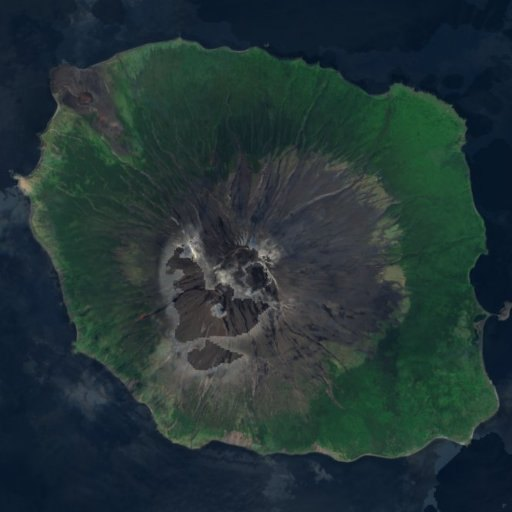
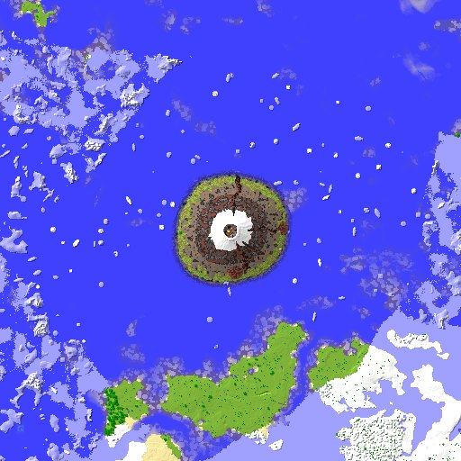
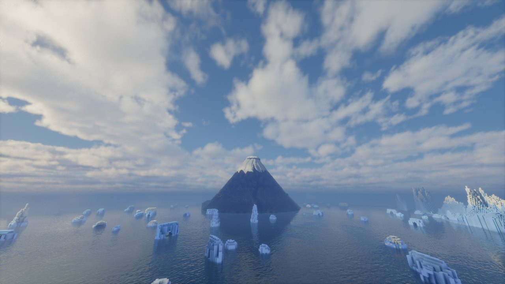

# Alaid Volcano / 알라이드 화산

**Real place:** Alaid volcano (Atlasov Island), Russia (Kuril Islands) (50.8610, 155.5650)

The highest Kuril volcano (2339 m): an almost perfect stratovolcano rising straight out of the sea as Atlasov Island, snow-capped, with a summit crater.

**In game:** `biomesmod:alaid_volcano`, a site of 680–920 blocks across (original terrain, shaped by landforms). Find the nearest one with `/biomesmod sites alaid_volcano`.

| Satellite (real place) | In-game map (top-down) | In-game view |
|---|---|---|
|  |  |  |

Satellite: [Sentinel-2 cloudless 2016 by EOX IT Services GmbH (contains modified Copernicus Sentinel data 2016)](https://s2maps.eu), CC BY 4.0 ([licence](https://creativecommons.org/licenses/by/4.0/)). In-game images: seed 0, Minecraft 26.2; the view uses Iris + Bliss shaders, Sodium and Voxy.

[Back to the gallery](README.md)
