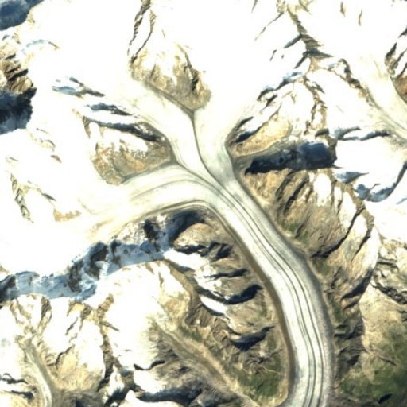
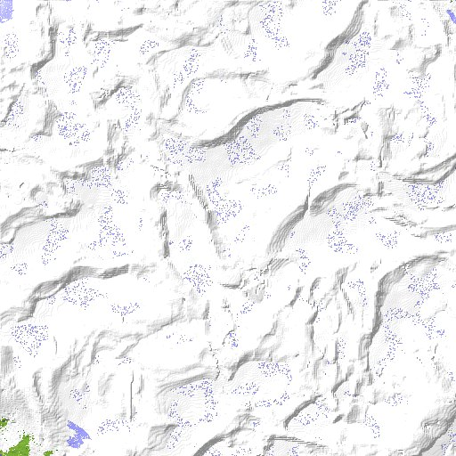
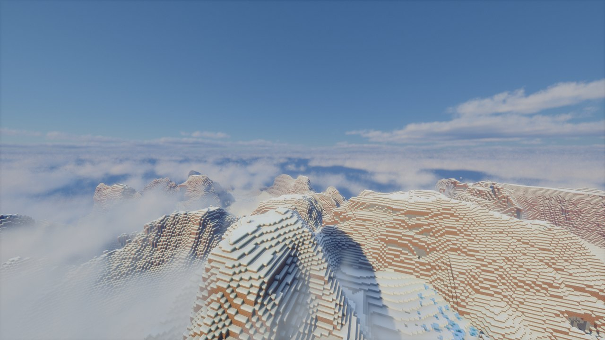

# Aletsch Glacier / 알레치 빙하

**Real place:** Great Aletsch Glacier at Konkordiaplatz, Switzerland (46.4930, 8.0360)

The Alps' largest glacier (23 km): at Konkordiaplatz four ice streams merge into a 900 m thick ice plain, striped by dark medial moraines, below the Jungfrau peaks.

**In game:** `biomesmod:aletsch_glacier`, a site of 960–1240 blocks across (mountains, low land raised, y=208). Find the nearest one with `/biomesmod sites aletsch_glacier`.

| Satellite (real place) | In-game map (top-down) | In-game view |
|---|---|---|
|  |  |  |

Satellite: [Sentinel-2 cloudless 2016 by EOX IT Services GmbH (contains modified Copernicus Sentinel data 2016)](https://s2maps.eu), CC BY 4.0 ([licence](https://creativecommons.org/licenses/by/4.0/)). In-game images: seed 0, Minecraft 26.2; the view uses Iris + Bliss shaders, Sodium and Voxy.

[Back to the gallery](README.md)
