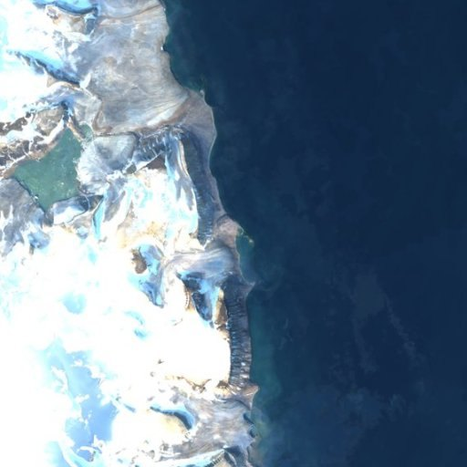
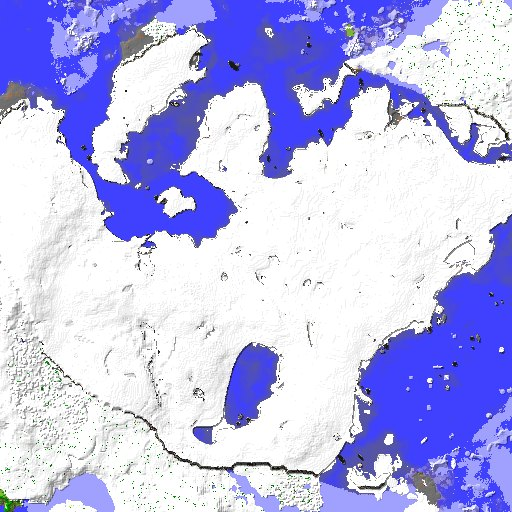
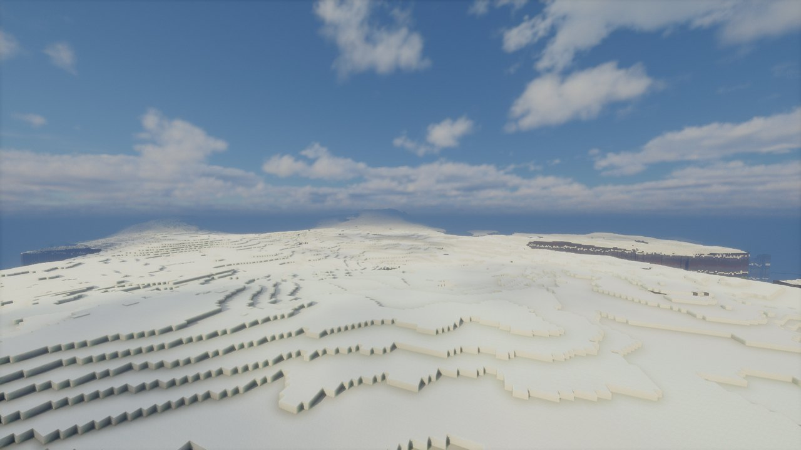

# Alkefjellet / 알케피엘레

**Real place:** Alkefjellet bird cliff, Hinlopen Strait (Lomfjordhalvøya, Ny-Friesland), Norway (Svalbard) (79.4466, 18.8152)

A wall of dark dolerite columns about 100 m high rising straight out of Hinlopenstretet, home to some 60,000 pairs of Brünnich's guillemots; the ledges are streaked white with guano and patched with rust-coloured lichen and green moss, snow lies on the plateau above and ice floes drift below.

**In game:** `biomesmod:alkefjellet`, a site of 760–1040 blocks across (original terrain, shaped by landforms). Find the nearest one with `/biomesmod sites alkefjellet`.

| Satellite (real place) | In-game map (top-down) | In-game view |
|---|---|---|
|  |  |  |

Satellite: [Sentinel-2 cloudless 2016 by EOX IT Services GmbH (contains modified Copernicus Sentinel data 2016)](https://s2maps.eu), CC BY 4.0 ([licence](https://creativecommons.org/licenses/by/4.0/)). In-game images: seed 0, Minecraft 26.2; the view uses Iris + Bliss shaders, Sodium and Voxy.

[Back to the gallery](README.md)
