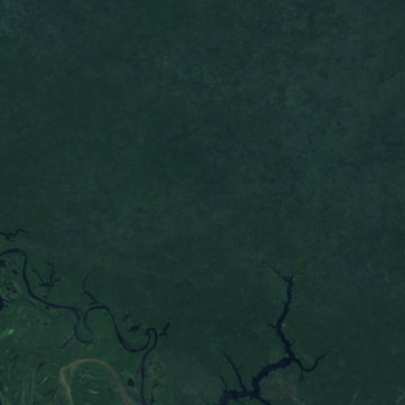
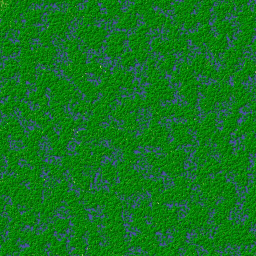
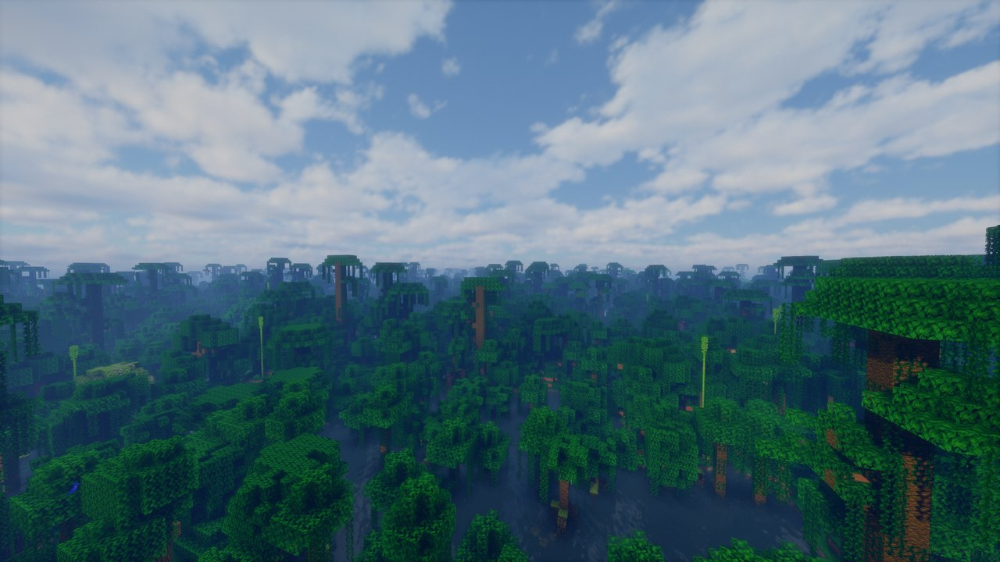

# Amazon Várzea / 아마존 바르제아

**Real place:** Solimões (Amazon) várzea floodplain near Codajás, Brazil (-3.4653, -62.2159)

Seasonally flooded whitewater forest along the Solimões: a mosaic of oxbow lakes, channels and tall forest standing in water for months.

**In game:** `biomesmod:amazon_varzea`, a site of 1240–1600 blocks across (flat low basin, y=64). Find the nearest one with `/biomesmod sites amazon_varzea`.

| Satellite (real place) | In-game map (top-down) | In-game view |
|---|---|---|
|  |  |  |

Satellite: [Sentinel-2 cloudless 2016 by EOX IT Services GmbH (contains modified Copernicus Sentinel data 2016)](https://s2maps.eu), CC BY 4.0 ([licence](https://creativecommons.org/licenses/by/4.0/)). In-game images: seed 0, Minecraft 26.2; the view uses Iris + Bliss shaders, Sodium and Voxy.

[Back to the gallery](README.md)
