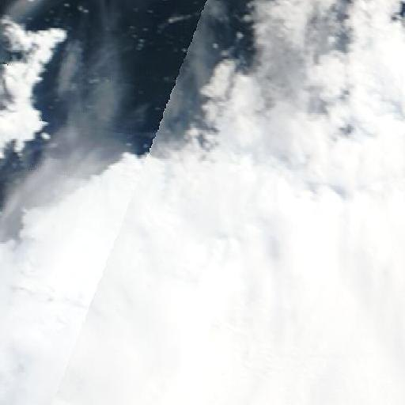
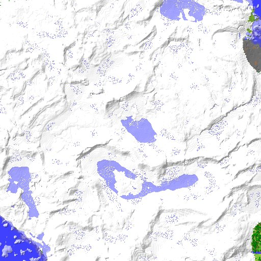
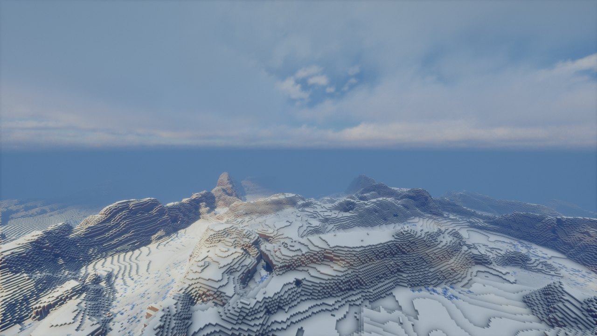

# Antarctic Peninsula / 남극 반도

**Real place:** Davis Coast, Graham Land (Antarctic Peninsula), Antarctica (-64.0000, -60.0000)

Alpine peaks and plateau ice of the Antarctic Peninsula spill as crevassed glaciers into fjords and end in ice cliffs; 3 m of snow-equivalent a year.

**In game:** `biomesmod:antarctic_peninsula`, a site of 960–1240 blocks across (mountains, low land raised, y=100). Find the nearest one with `/biomesmod sites antarctic_peninsula`.

| Satellite (real place) | In-game map (top-down) | In-game view |
|---|---|---|
|  |  |  |

Satellite: [NASA Worldview / GIBS (MODIS Terra corrected reflectance)](https://worldview.earthdata.nasa.gov), public domain ([licence](https://www.earthdata.nasa.gov/engage/open-data-services-software-policies)). In-game images: seed 0, Minecraft 26.2; the view uses Iris + Bliss shaders, Sodium and Voxy.

[Back to the gallery](README.md)
