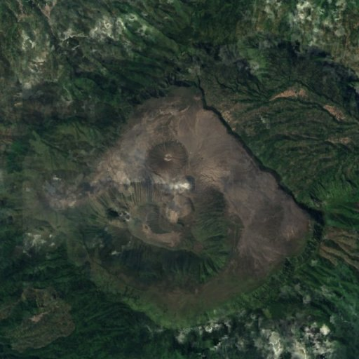
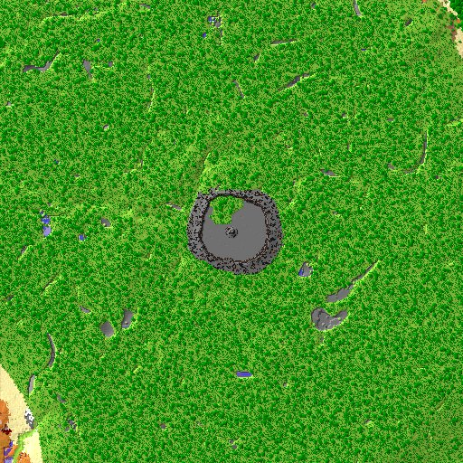
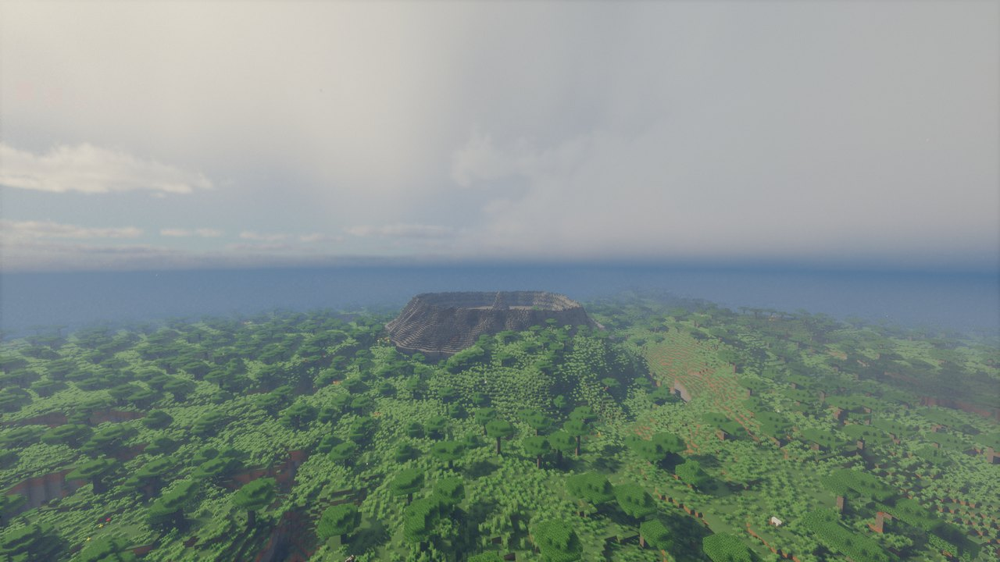

# Bromo Tengger / 브로모 텡게르

**Real place:** Mount Bromo in the Tengger caldera, Indonesia (East Java) (-7.9414, 112.9508)

Inside the 10 km Tengger caldera lies a 'sea of sand' of grey volcanic ash, from which rise the smoking Bromo crater and the perfectly fluted Batok cone.

**In game:** `biomesmod:bromo_tengger`, a site of 920–1200 blocks across (raised land, y=192). Find the nearest one with `/biomesmod sites bromo_tengger`.

| Satellite (real place) | In-game map (top-down) | In-game view |
|---|---|---|
|  |  |  |

Satellite: [Sentinel-2 cloudless 2016 by EOX IT Services GmbH (contains modified Copernicus Sentinel data 2016)](https://s2maps.eu), CC BY 4.0 ([licence](https://creativecommons.org/licenses/by/4.0/)). In-game images: seed 0, Minecraft 26.2; the view uses Iris + Bliss shaders, Sodium and Voxy.

[Back to the gallery](README.md)
