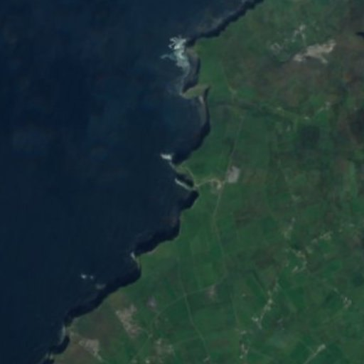
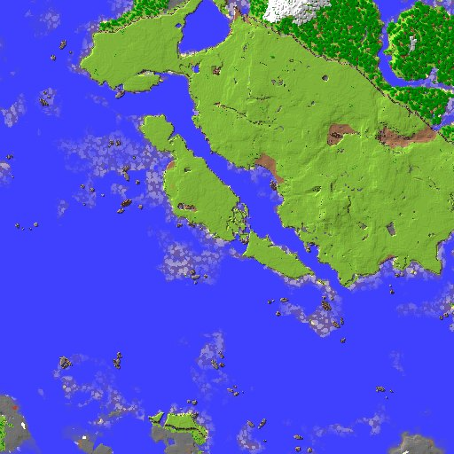
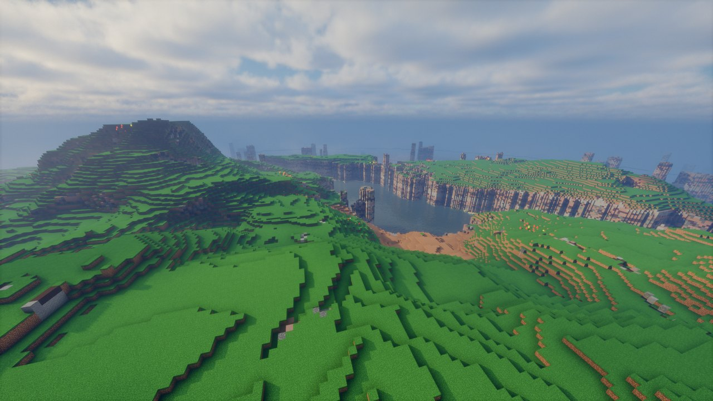

# Cliffs of Moher / 모허 절벽

**Real place:** Cliffs of Moher (O'Brien's Tower), Ireland (52.9715, -9.4309)

Layered sandstone and shale cliffs rise 214 m straight from the Atlantic for 14 km, topped by green grass, with sea stacks such as Branaunmore at their foot.

**In game:** `biomesmod:cliffs_of_moher`, a site of 760–1040 blocks across (original terrain, shaped by landforms). Find the nearest one with `/biomesmod sites cliffs_of_moher`.

| Satellite (real place) | In-game map (top-down) | In-game view |
|---|---|---|
|  |  |  |

Satellite: [Sentinel-2 cloudless 2016 by EOX IT Services GmbH (contains modified Copernicus Sentinel data 2016)](https://s2maps.eu), CC BY 4.0 ([licence](https://creativecommons.org/licenses/by/4.0/)). In-game images: seed 0, Minecraft 26.2; the view uses Iris + Bliss shaders, Sodium and Voxy.

[Back to the gallery](README.md)
