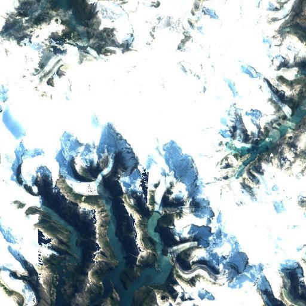
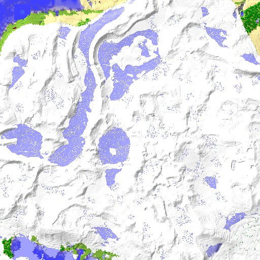
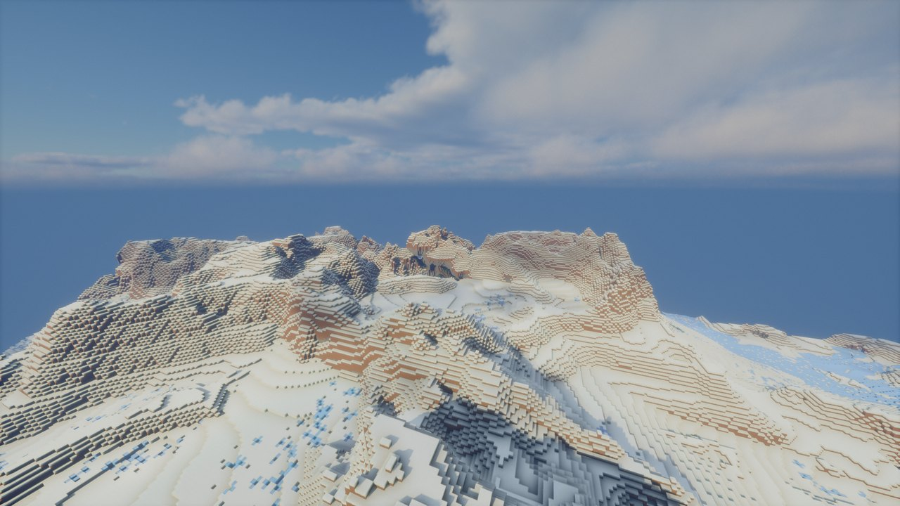

# Cordillera Darwin / 다윈 산맥

**Real place:** Cordillera Darwin ice field, Tierra del Fuego, Chile (-54.6808, -69.6212)

An ice-capped range rising to 2,500 m out of the Beagle Channel; tidewater glaciers ('Glacier Alley') tumble from the ice field to the sea.

**In game:** `biomesmod:cordillera_darwin`, a site of 764–936 blocks across (mountains, low land raised, y=126). Find the nearest one with `/biomesmod sites cordillera_darwin`.

| Satellite (real place) | In-game map (top-down) | In-game view |
|---|---|---|
|  |  |  |

Satellite: [Sentinel-2 cloudless 2016 by EOX IT Services GmbH (contains modified Copernicus Sentinel data 2016)](https://s2maps.eu), CC BY 4.0 ([licence](https://creativecommons.org/licenses/by/4.0/)). In-game images: seed 0, Minecraft 26.2; the view uses Iris + Bliss shaders, Sodium and Voxy.

[Back to the gallery](README.md)
