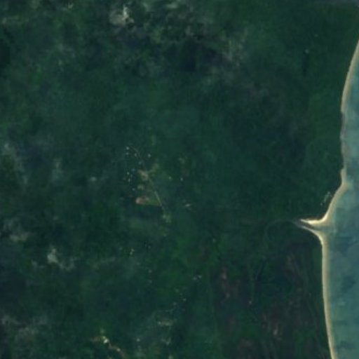
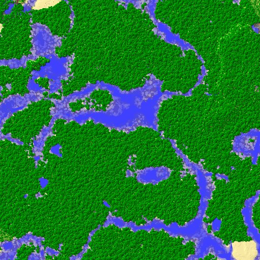
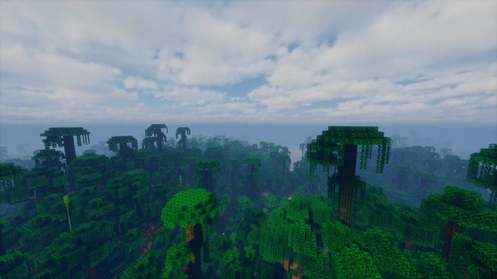

# Daintree Rainforest / 데인트리 열대우림

**Real place:** Daintree Rainforest at Cape Tribulation coast, Australia (-16.1700, 145.4180)

The world's oldest tropical rainforest runs right down to white beaches and fringing reef: buttressed trees, fan palms, strangler figs, mangroves in the creeks.

**In game:** `biomesmod:daintree`, a site of 900–1300 blocks across (original terrain, shaped by landforms). Find the nearest one with `/biomesmod sites daintree`.

| Satellite (real place) | In-game map (top-down) | In-game view |
|---|---|---|
|  |  |  |

Satellite: [Sentinel-2 cloudless 2016 by EOX IT Services GmbH (contains modified Copernicus Sentinel data 2016)](https://s2maps.eu), CC BY 4.0 ([licence](https://creativecommons.org/licenses/by/4.0/)). In-game images: seed 0, Minecraft 26.2; the view uses Iris + Bliss shaders, Sodium and Voxy.

[Back to the gallery](README.md)
