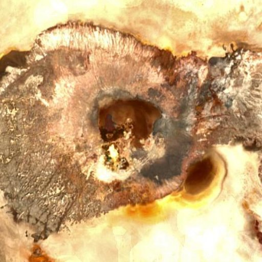
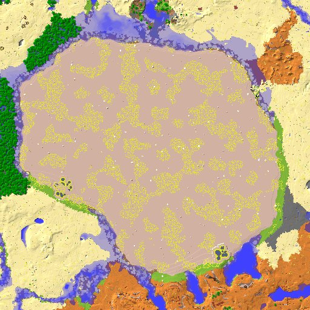
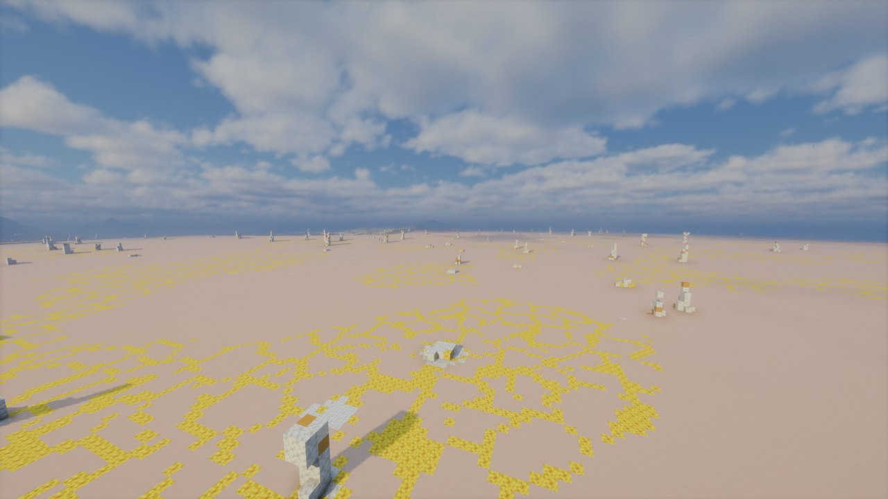

# Dallol / 달롤

**Real place:** Dallol hydrothermal field, Danakil Depression, Ethiopia (14.2410, 40.3000)

At -125 m, one of the hottest inhabited places on Earth: hot springs dissolve salt and sulfur into acid pools ringed by neon yellow, green and white crusts and salt chimneys.

**In game:** `biomesmod:dallol`, a site of 540–660 blocks across (flat low basin, y=60). Find the nearest one with `/biomesmod sites dallol`.

| Satellite (real place) | In-game map (top-down) | In-game view |
|---|---|---|
|  |  |  |

Satellite: [Sentinel-2 cloudless 2024 by EOX IT Services GmbH (contains modified Copernicus Sentinel data 2024)](https://s2maps.eu), CC BY-NC-SA 4.0 ([licence](https://creativecommons.org/licenses/by-nc-sa/4.0/)). In-game images: seed 0, Minecraft 26.2; the view uses Iris + Bliss shaders, Sodium and Voxy.

[Back to the gallery](README.md)
