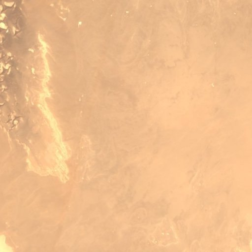
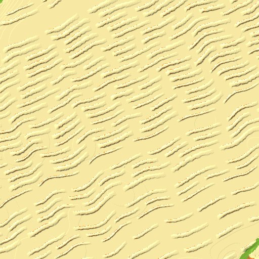
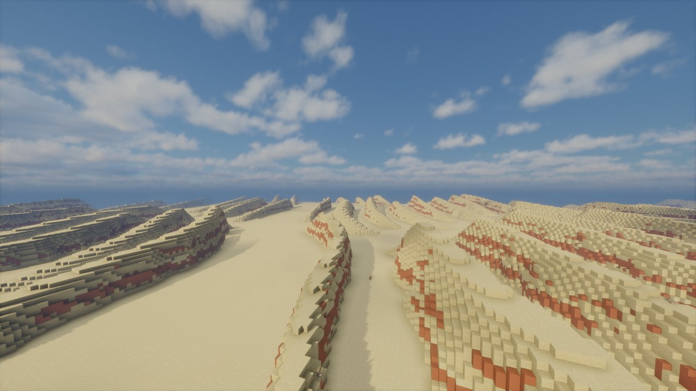

# Dasht-e Lut / 다쉬테 루트

**Real place:** Dasht-e Lut (Kaluts yardang field), Iran (30.2161, 58.8389)

One of the hottest places on Earth (70 C ground): wind has carved the Lut's silty sediments into the Kaluts, long parallel yardang ridges separated by sandy corridors.

**In game:** `biomesmod:dasht_e_lut`, a site of 1240–1500 blocks across (flat plateau, y=79). Find the nearest one with `/biomesmod sites dasht_e_lut`.

| Satellite (real place) | In-game map (top-down) | In-game view |
|---|---|---|
|  |  |  |

Satellite: [Sentinel-2 cloudless 2016 by EOX IT Services GmbH (contains modified Copernicus Sentinel data 2016)](https://s2maps.eu), CC BY 4.0 ([licence](https://creativecommons.org/licenses/by/4.0/)). In-game images: seed 0, Minecraft 26.2; the view uses Iris + Bliss shaders, Sodium and Voxy.

[Back to the gallery](README.md)
