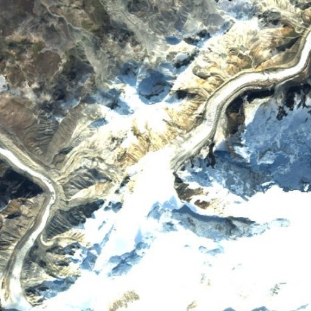
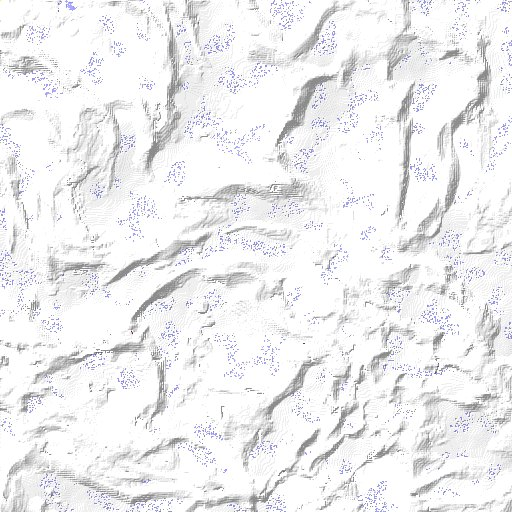
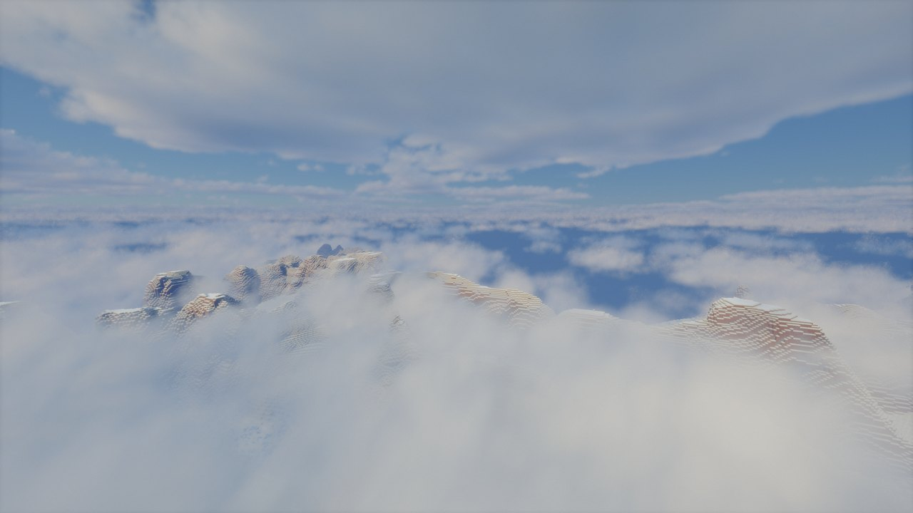

# Denali Massif / 디날리 산괴

**Real place:** Denali massif, north flank near Peters Dome and Jeffery Glacier, United States (Alaska) (63.1148, -151.1926)

The flanks of North America's highest peak: knife-edge ridges and domes above heavily crevassed glaciers that pour into the Muldrow and Peters basins.

**In game:** `biomesmod:denali_massif`, a site of 1040–1320 blocks across (mountains, low land raised, y=200). Find the nearest one with `/biomesmod sites denali_massif`.

| Satellite (real place) | In-game map (top-down) | In-game view |
|---|---|---|
|  |  |  |

Satellite: [Sentinel-2 cloudless 2016 by EOX IT Services GmbH (contains modified Copernicus Sentinel data 2016)](https://s2maps.eu), CC BY 4.0 ([licence](https://creativecommons.org/licenses/by/4.0/)). In-game images: seed 0, Minecraft 26.2; the view uses Iris + Bliss shaders, Sodium and Voxy.

[Back to the gallery](README.md)
