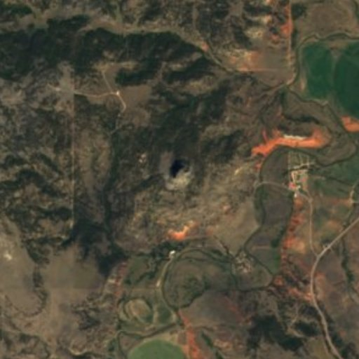
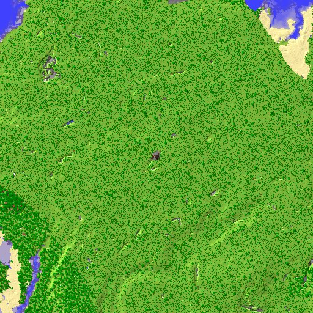
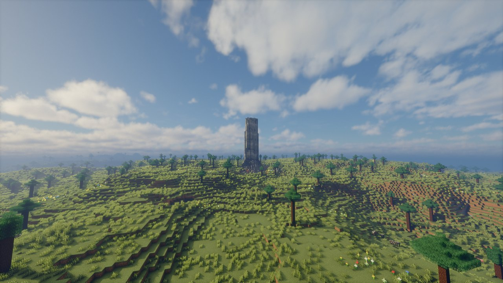

# Devils Tower / 데빌스 타워

**Real place:** Devils Tower, United States (44.5900, -104.7153)

A 265 m igneous butte of hexagonal columns rising above the Belle Fourche River prairie, ringed by a talus apron and ponderosa pines.

**In game:** `biomesmod:devils_tower`, a site of 800–1040 blocks across (raised land, y=110). Find the nearest one with `/biomesmod sites devils_tower`.

| Satellite (real place) | In-game map (top-down) | In-game view |
|---|---|---|
|  |  |  |

Satellite: [Sentinel-2 cloudless 2016 by EOX IT Services GmbH (contains modified Copernicus Sentinel data 2016)](https://s2maps.eu), CC BY 4.0 ([licence](https://creativecommons.org/licenses/by/4.0/)). In-game images: seed 0, Minecraft 26.2; the view uses Iris + Bliss shaders, Sodium and Voxy.

[Back to the gallery](README.md)
