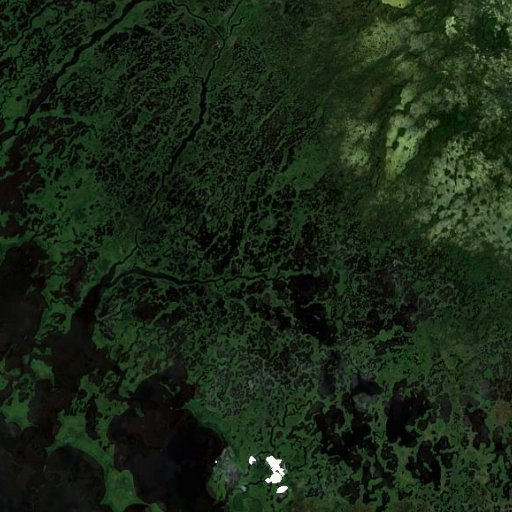
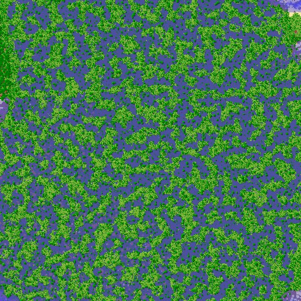
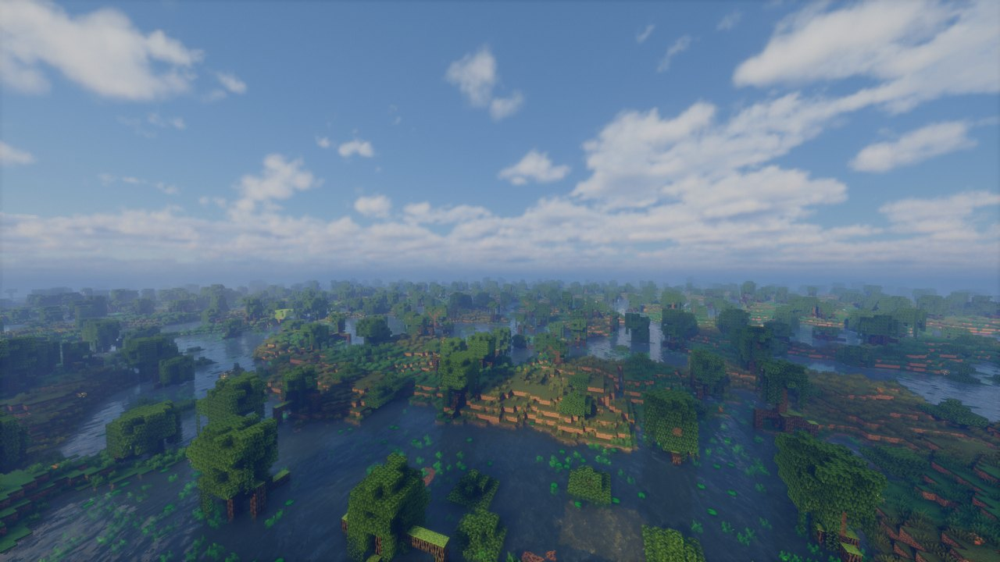

# Everglades / 에버글레이즈

**Real place:** Everglades backcountry near Hells Bay, United States (Florida) (25.2866, -80.8987)

Where the 'river of grass' meets the mangrove backcountry: sawgrass marsh, tree islands and a maze of tannin-dark mangrove creeks and bays.

**In game:** `biomesmod:everglades`, a site of 1120–1520 blocks across (flat low basin, y=63). Find the nearest one with `/biomesmod sites everglades`.

| Satellite (real place) | In-game map (top-down) | In-game view |
|---|---|---|
|  |  |  |

Satellite: [Sentinel-2 cloudless 2024 by EOX IT Services GmbH (contains modified Copernicus Sentinel data 2024)](https://s2maps.eu), CC BY-NC-SA 4.0 ([licence](https://creativecommons.org/licenses/by-nc-sa/4.0/)). In-game images: seed 0, Minecraft 26.2; the view uses Iris + Bliss shaders, Sodium and Voxy.

[Back to the gallery](README.md)
