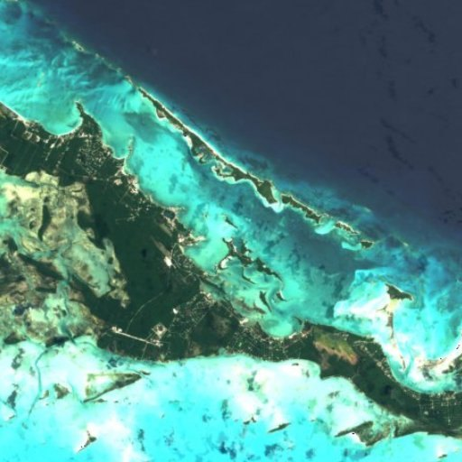
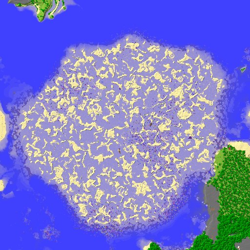
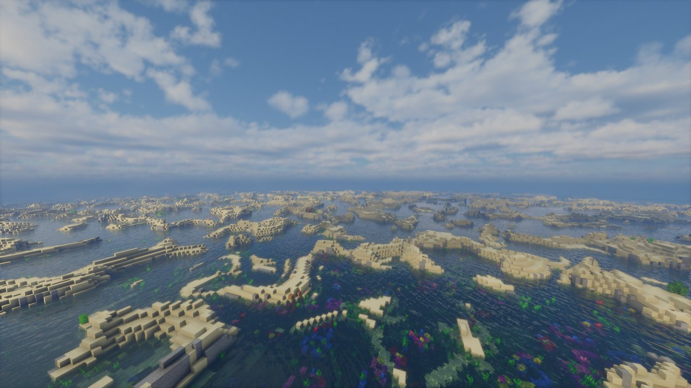

# Exuma Cays / 엑수마 케이스

**Real place:** Great Exuma and the Exuma Cays (George Town), Bahamas (23.5000, -75.7500)

Hundreds of low limestone cays on the edge of the Great Bahama Bank: sandbars and turquoise shallows a few metres deep, with mangroves and casuarina on the islands.

**In game:** `biomesmod:exuma_cays`, a site of 652–798 blocks across (flat low basin, y=59). Find the nearest one with `/biomesmod sites exuma_cays`.

| Satellite (real place) | In-game map (top-down) | In-game view |
|---|---|---|
|  |  |  |

Satellite: [Sentinel-2 cloudless 2016 by EOX IT Services GmbH (contains modified Copernicus Sentinel data 2016)](https://s2maps.eu), CC BY 4.0 ([licence](https://creativecommons.org/licenses/by/4.0/)). In-game images: seed 0, Minecraft 26.2; the view uses Iris + Bliss shaders, Sodium and Voxy.

[Back to the gallery](README.md)
