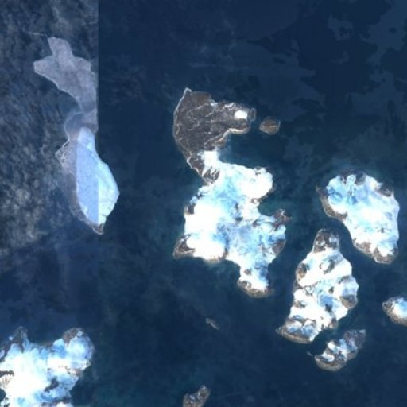
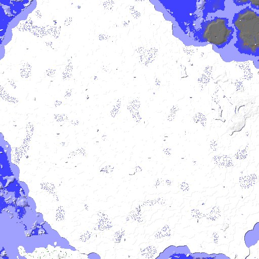
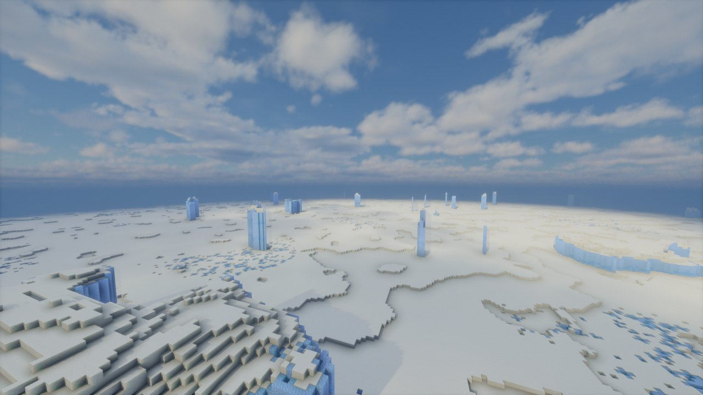

# Franz Josef Land / 프란츠요제프 제도

**Real place:** Nansen Island ice cap, Franz Josef Land, Russia (80.5000, 54.0000)

Basalt islands of Franz Josef Land are buried under domed ice caps that end in ice cliffs at the sea; only black basalt capes poke through.

**In game:** `biomesmod:franz_josef_land`, a site of 900–1200 blocks across (original terrain, shaped by landforms). Find the nearest one with `/biomesmod sites franz_josef_land`.

| Satellite (real place) | In-game map (top-down) | In-game view |
|---|---|---|
|  |  |  |

Satellite: [Sentinel-2 cloudless 2016 by EOX IT Services GmbH (contains modified Copernicus Sentinel data 2016)](https://s2maps.eu), CC BY 4.0 ([licence](https://creativecommons.org/licenses/by/4.0/)). In-game images: seed 0, Minecraft 26.2; the view uses Iris + Bliss shaders, Sodium and Voxy.

[Back to the gallery](README.md)
