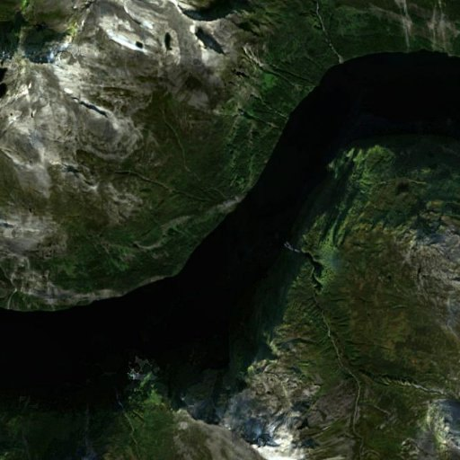
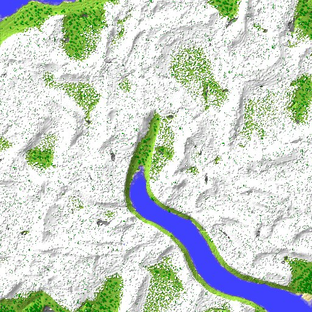
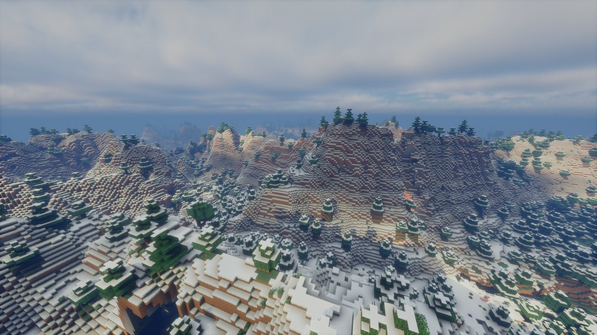

# Geirangerfjord / 예이랑에르피오르

**Real place:** Geirangerfjord at the Seven Sisters falls, Norway (62.1040, 7.0940)

A 15 km fjord between near-vertical walls up to 1,400 m; the Seven Sisters waterfalls fall straight into the deep green water.

**In game:** `biomesmod:geirangerfjord`, a site of 960–1240 blocks across (mountains, low land raised, y=122). Find the nearest one with `/biomesmod sites geirangerfjord`.

| Satellite (real place) | In-game map (top-down) | In-game view |
|---|---|---|
|  |  |  |

Satellite: [Sentinel-2 cloudless 2024 by EOX IT Services GmbH (contains modified Copernicus Sentinel data 2024)](https://s2maps.eu), CC BY-NC-SA 4.0 ([licence](https://creativecommons.org/licenses/by-nc-sa/4.0/)). In-game images: seed 0, Minecraft 26.2; the view uses Iris + Bliss shaders, Sodium and Voxy.

[Back to the gallery](README.md)
