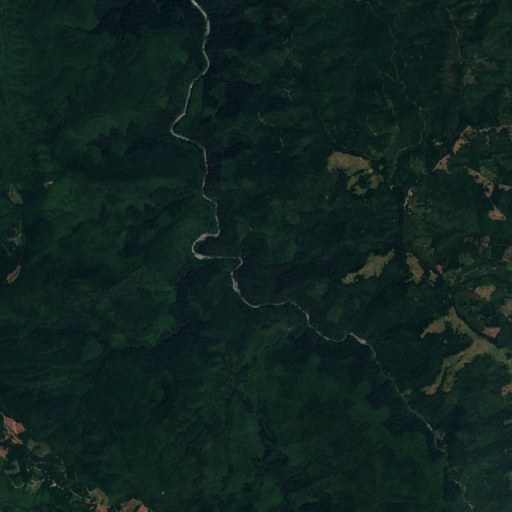
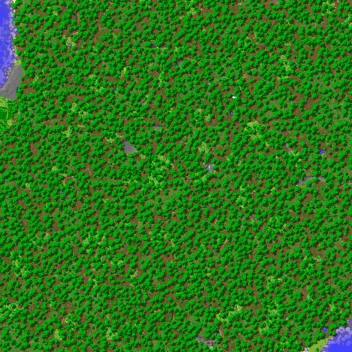
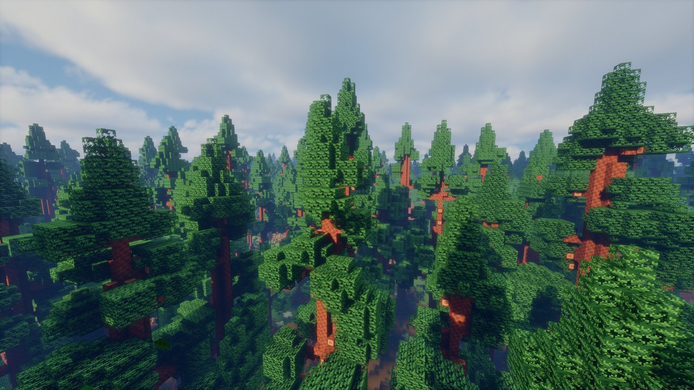

# Giant Redwood Forest / 거대나무숲

**Real place:** Tall Trees Grove, Redwood National Park, United States (California) (41.2075, -123.9971)

Coast redwoods, the tallest trees on Earth (over 110 m), stand in fog-fed groves along Redwood Creek: thick red fibrous trunks rising from a fern and moss floor into a closed canopy far overhead.

**In game:** `biomesmod:giant_redwood_forest`, a site of 960–1240 blocks across (raised land, y=84). Find the nearest one with `/biomesmod sites giant_redwood_forest`.

| Satellite (real place) | In-game map (top-down) | In-game view |
|---|---|---|
|  |  |  |

Satellite: [Sentinel-2 cloudless 2016 by EOX IT Services GmbH (contains modified Copernicus Sentinel data 2016)](https://s2maps.eu), CC BY 4.0 ([licence](https://creativecommons.org/licenses/by/4.0/)). In-game images: seed 0, Minecraft 26.2; the view uses Iris + Bliss shaders, Sodium and Voxy.

[Back to the gallery](README.md)
