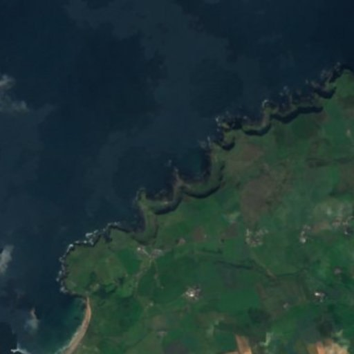
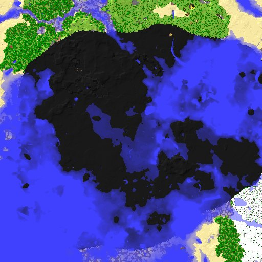
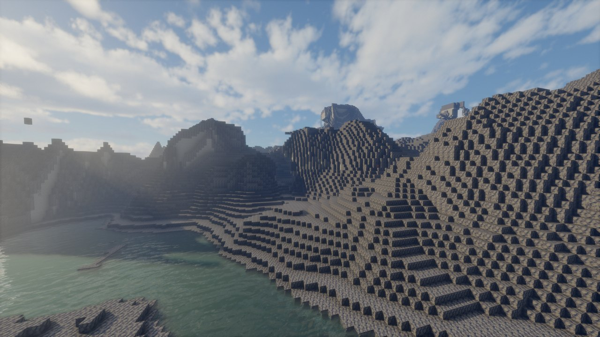

# Giant's Causeway / 자이언츠 코즈웨이

**Real place:** Giant's Causeway, United Kingdom (Northern Ireland) (55.2408, -6.5116)

About 40,000 interlocking basalt columns, mostly hexagonal, step down from the cliff foot into the sea like paving stones, below dark basalt cliffs and green headland.

**In game:** `biomesmod:giants_causeway`, a site of 640–880 blocks across (original terrain, shaped by landforms). Find the nearest one with `/biomesmod sites giants_causeway`.

| Satellite (real place) | In-game map (top-down) | In-game view |
|---|---|---|
|  |  |  |

Satellite: [Sentinel-2 cloudless 2016 by EOX IT Services GmbH (contains modified Copernicus Sentinel data 2016)](https://s2maps.eu), CC BY 4.0 ([licence](https://creativecommons.org/licenses/by/4.0/)). In-game images: seed 0, Minecraft 26.2; the view uses Iris + Bliss shaders, Sodium and Voxy.

[Back to the gallery](README.md)
