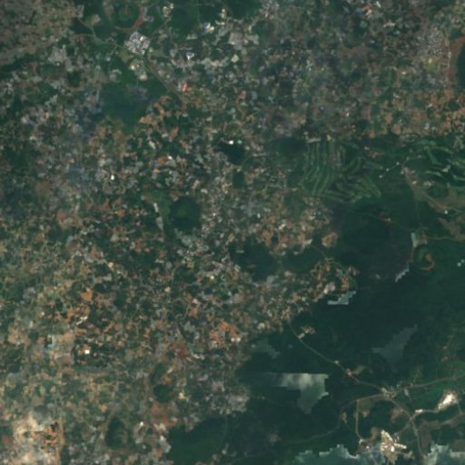
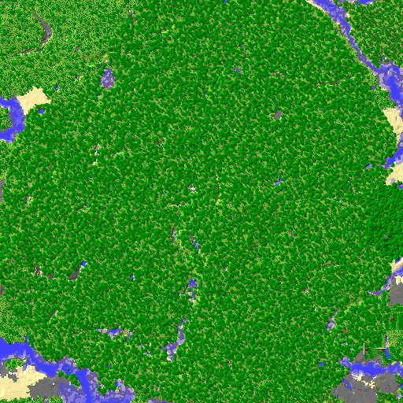
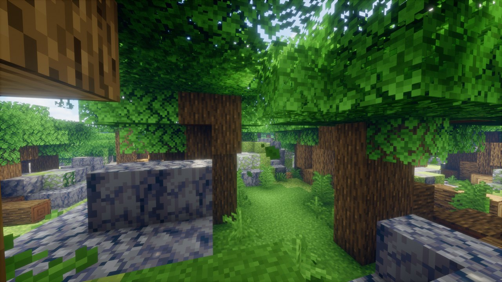

# Gotjawal / 곶자왈

**Real place:** Hangyeong-Joncheon Gotjawal (Jeju Island), South Korea (33.3300, 126.2600)

Gotjawal is Jeju's forest on rough 'a'a lava fields: a dense evergreen and deciduous woodland growing straight out of jumbled basalt blocks, with mossy rocks, vines and ferns, never cleared for farming because the ground is too rough.

**In game:** `biomesmod:gotjawal`, a site of 540–660 blocks across (raised land, y=75). Find the nearest one with `/biomesmod sites gotjawal`.

| Satellite (real place) | In-game map (top-down) | In-game view |
|---|---|---|
|  |  |  |

Satellite: [Sentinel-2 cloudless 2016 by EOX IT Services GmbH (contains modified Copernicus Sentinel data 2016)](https://s2maps.eu), CC BY 4.0 ([licence](https://creativecommons.org/licenses/by/4.0/)). In-game images: seed 0, Minecraft 26.2; the view uses Iris + Bliss shaders, Sodium and Voxy.

[Back to the gallery](README.md)
