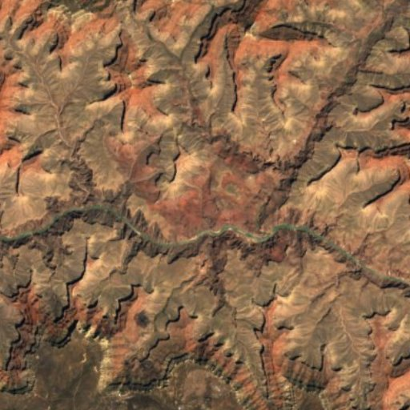
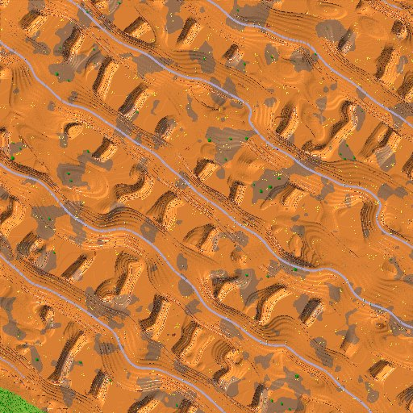
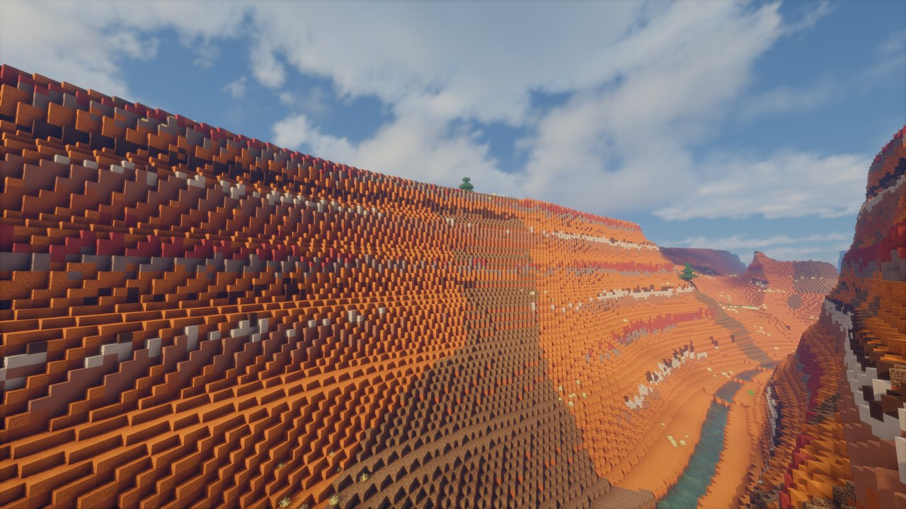

# Grand Canyon / 그랜드 캐니언

**Real place:** Grand Canyon (South Rim, Plateau Point), United States (36.1069, -112.1129)

The Colorado River has cut 1.8 km into the Kaibab Plateau: stepped walls of red, buff and grey rock layers, side canyons and buttes, the river far below.

**In game:** `biomesmod:grand_canyon`, a site of 1120–1400 blocks across (flat plateau, y=192). Find the nearest one with `/biomesmod sites grand_canyon`.

| Satellite (real place) | In-game map (top-down) | In-game view |
|---|---|---|
|  |  |  |

Satellite: [Sentinel-2 cloudless 2016 by EOX IT Services GmbH (contains modified Copernicus Sentinel data 2016)](https://s2maps.eu), CC BY 4.0 ([licence](https://creativecommons.org/licenses/by/4.0/)). In-game images: seed 0, Minecraft 26.2; the view uses Iris + Bliss shaders, Sodium and Voxy.

[Back to the gallery](README.md)
