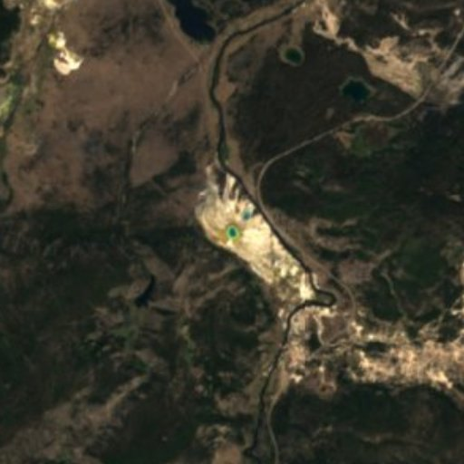
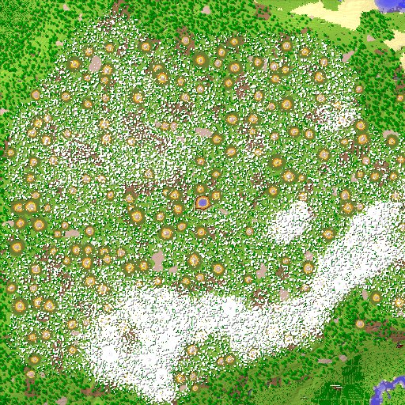
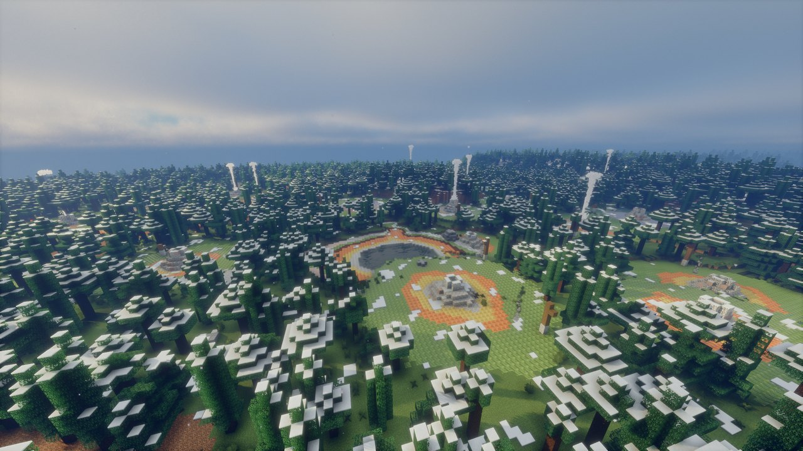

# Grand Prismatic / 그랜드 프리즈매틱

**Real place:** Grand Prismatic Spring, Midway Geyser Basin (Yellowstone), United States (44.5251, -110.8382)

The largest hot spring in the US: a deep-blue pool ringed by green, yellow and orange microbial mats that streak outward over white sinter, in lodgepole-pine country.

**In game:** `biomesmod:grand_prismatic`, a site of 540–660 blocks across (flat plateau, y=196). Find the nearest one with `/biomesmod sites grand_prismatic`.

| Satellite (real place) | In-game map (top-down) | In-game view |
|---|---|---|
|  |  |  |

Satellite: [Sentinel-2 cloudless 2016 by EOX IT Services GmbH (contains modified Copernicus Sentinel data 2016)](https://s2maps.eu), CC BY 4.0 ([licence](https://creativecommons.org/licenses/by/4.0/)). In-game images: seed 0, Minecraft 26.2; the view uses Iris + Bliss shaders, Sodium and Voxy.

[Back to the gallery](README.md)
