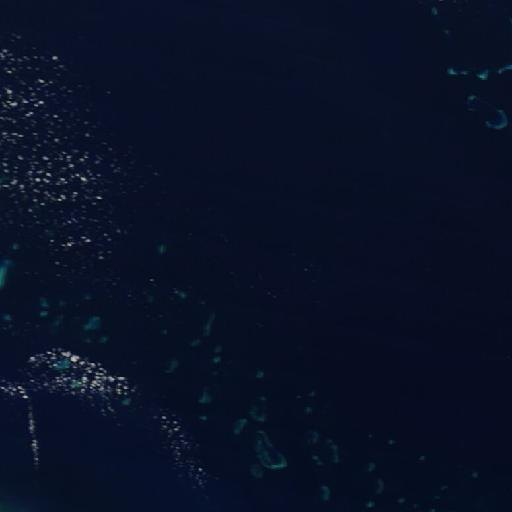
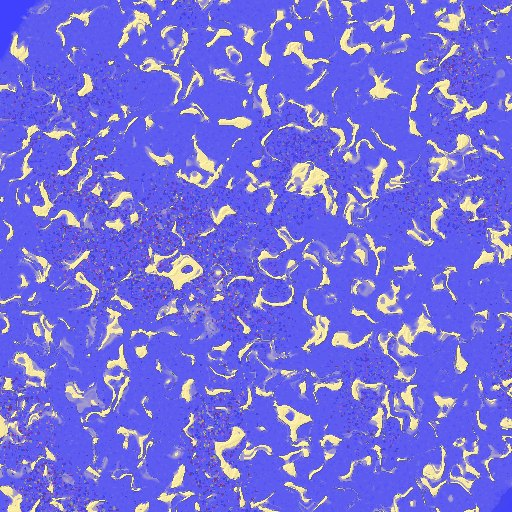
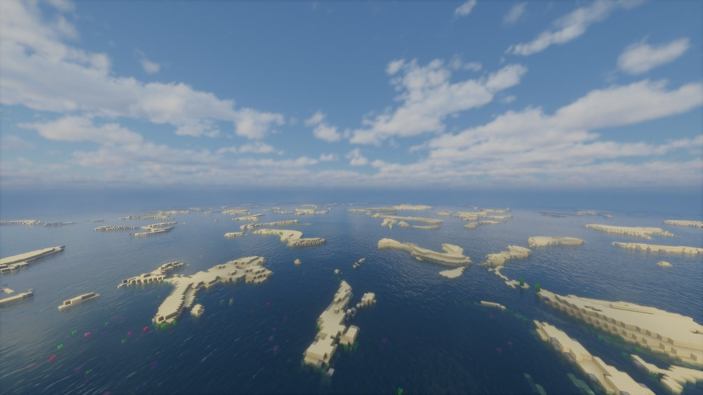

# Great Barrier Reef / 그레이트 배리어 리프

**Real place:** Central Great Barrier Reef, outer reefs off Townsville, Australia (-18.2871, 147.6992)

Platform reefs of the outer central GBR: coral gardens rising to the surface from a 50 m deep shelf, with sand cays, lagoons and very clear water.

**In game:** `biomesmod:great_barrier_reef`, a site of 1120–1520 blocks across (flat low basin, y=55). Find the nearest one with `/biomesmod sites great_barrier_reef`.

| Satellite (real place) | In-game map (top-down) | In-game view |
|---|---|---|
|  |  |  |

Satellite: [NASA Worldview / GIBS (MODIS Terra corrected reflectance)](https://worldview.earthdata.nasa.gov), public domain ([licence](https://www.earthdata.nasa.gov/engage/open-data-services-software-policies)). In-game images: seed 0, Minecraft 26.2; the view uses Iris + Bliss shaders, Sodium and Voxy.

[Back to the gallery](README.md)
