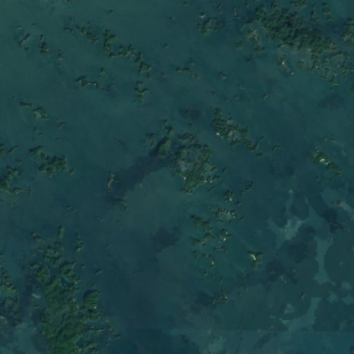
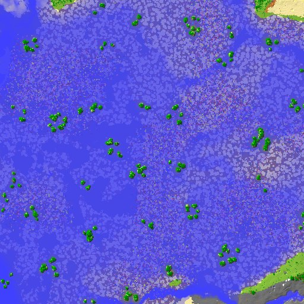
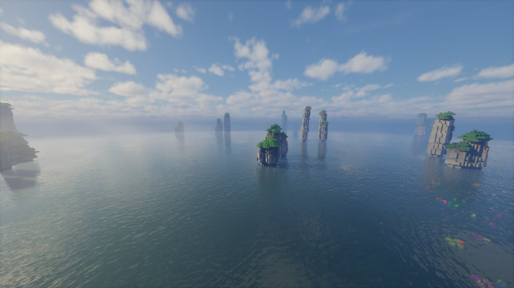

# Ha Long Bay / 하롱베이

**Real place:** Hạ Long Bay (Bái Tử Long side, Vân Đồn), Vietnam (20.8330, 107.1610)

Some 1,600 limestone karst towers and islets, sheer-sided and jungle-capped, rise from emerald water, notched at the waterline by waves.

**In game:** `biomesmod:ha_long_bay`, a site of 920–1280 blocks across (flat low basin, y=55). Find the nearest one with `/biomesmod sites ha_long_bay`.

| Satellite (real place) | In-game map (top-down) | In-game view |
|---|---|---|
|  |  |  |

Satellite: [Sentinel-2 cloudless 2016 by EOX IT Services GmbH (contains modified Copernicus Sentinel data 2016)](https://s2maps.eu), CC BY 4.0 ([licence](https://creativecommons.org/licenses/by/4.0/)). In-game images: seed 0, Minecraft 26.2; the view uses Iris + Bliss shaders, Sodium and Voxy.

[Back to the gallery](README.md)
