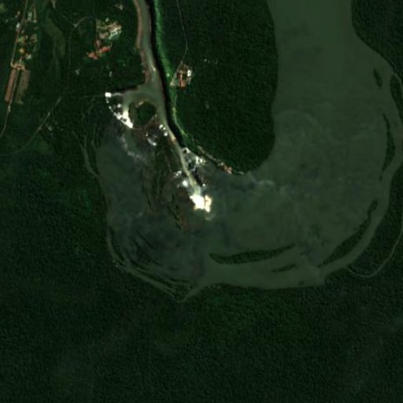
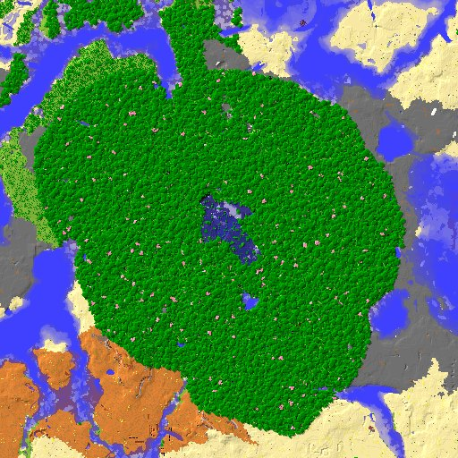
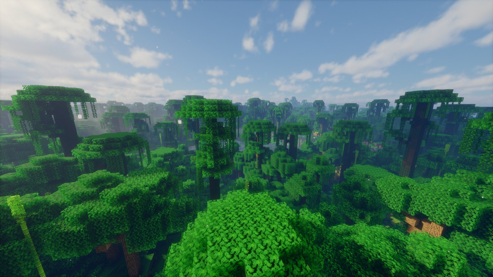

# Iguazu Falls / 이구아수 폭포

**Real place:** Iguazu Falls (Devil's Throat), Argentina / Brazil (-25.6953, -54.4367)

275 falls along 2.7 km of a basalt escarpment; the Devil's Throat is a U-shaped chasm where half the river plunges 80 m, in dense Atlantic rainforest with constant spray.

**In game:** `biomesmod:iguazu_falls`, a site of 540–660 blocks across (raised land, y=72). Find the nearest one with `/biomesmod sites iguazu_falls`.

| Satellite (real place) | In-game map (top-down) | In-game view |
|---|---|---|
|  |  |  |

Satellite: [Sentinel-2 cloudless 2024 by EOX IT Services GmbH (contains modified Copernicus Sentinel data 2024)](https://s2maps.eu), CC BY-NC-SA 4.0 ([licence](https://creativecommons.org/licenses/by-nc-sa/4.0/)). In-game images: seed 0, Minecraft 26.2; the view uses Iris + Bliss shaders, Sodium and Voxy.

[Back to the gallery](README.md)
