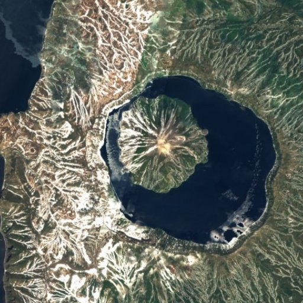
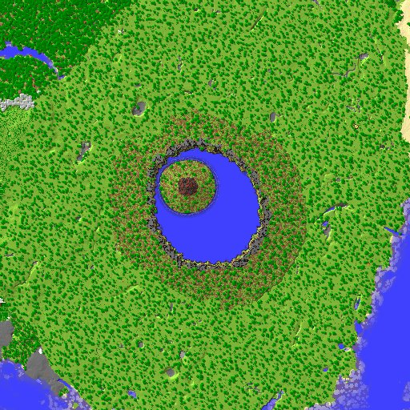
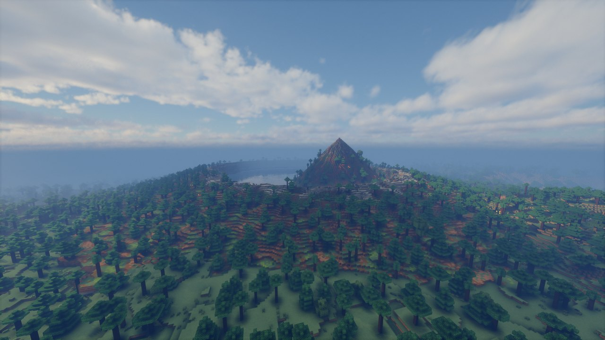

# Krenitsyn Caldera / 크레니친 칼데라

**Real place:** Krenitsyn Peak in Lake Koltsevoye (Tao-Rusyr caldera), Onekotan, Russia (Kuril Islands) (49.3500, 154.7000)

Onekotan's southern Tao-Rusyr caldera holds the ring-shaped Lake Koltsevoye, with the young Krenitsyn cone (1324 m) rising from the water as an island.

**In game:** `biomesmod:krenitsyn_caldera`, a site of 800–1040 blocks across (raised land, y=81). Find the nearest one with `/biomesmod sites krenitsyn_caldera`.

| Satellite (real place) | In-game map (top-down) | In-game view |
|---|---|---|
|  |  |  |

Satellite: [Sentinel-2 cloudless 2016 by EOX IT Services GmbH (contains modified Copernicus Sentinel data 2016)](https://s2maps.eu), CC BY 4.0 ([licence](https://creativecommons.org/licenses/by/4.0/)). In-game images: seed 0, Minecraft 26.2; the view uses Iris + Bliss shaders, Sodium and Voxy.

[Back to the gallery](README.md)
