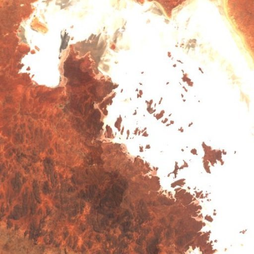
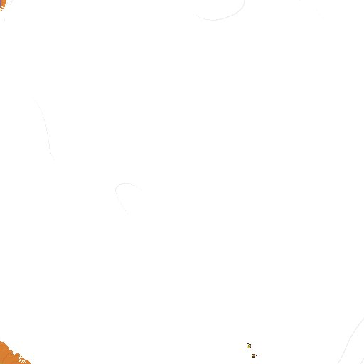
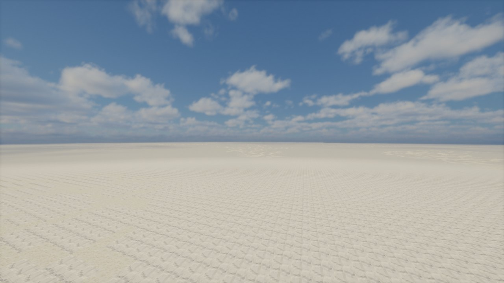

# Lake Gairdner / 게어드너 호

**Real place:** Lake Gairdner, Australia (South Australia) (-31.6972, 135.8536)

A 160 km salt lake in the outback with a crust over a metre thick, bright white against red sand and low granite hills; used for land-speed records.

**In game:** `biomesmod:lake_gairdner`, a site of 1120–1400 blocks across (flat plateau, y=68). Find the nearest one with `/biomesmod sites lake_gairdner`.

| Satellite (real place) | In-game map (top-down) | In-game view |
|---|---|---|
|  |  |  |

Satellite: [Sentinel-2 cloudless 2016 by EOX IT Services GmbH (contains modified Copernicus Sentinel data 2016)](https://s2maps.eu), CC BY 4.0 ([licence](https://creativecommons.org/licenses/by/4.0/)). In-game images: seed 0, Minecraft 26.2; the view uses Iris + Bliss shaders, Sodium and Voxy.

[Back to the gallery](README.md)
