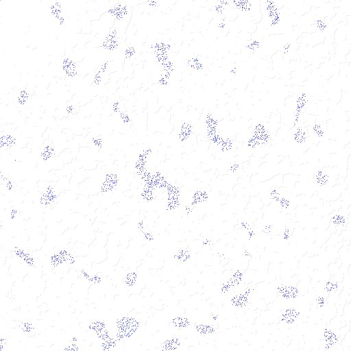
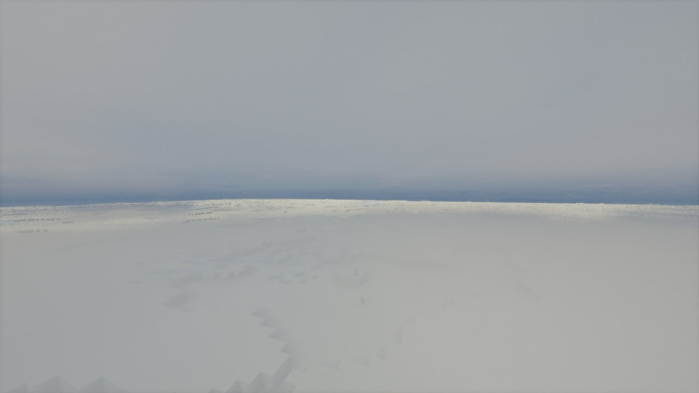

# Vostok Plateau / 보스토크 고원

**Real place:** East Antarctic Plateau over Lake Vostok, Antarctica (-77.5000, 106.0000)

The coldest place on Earth (-89 C recorded): a featureless ice plateau 3.5 km high, sitting on top of the buried subglacial Lake Vostok.

**In game:** `biomesmod:lake_vostok_plateau`, a site of 1300–1600 blocks across (flat plateau, y=227). Find the nearest one with `/biomesmod sites lake_vostok_plateau`.

| Satellite (real place) | In-game map (top-down) | In-game view |
|---|---|---|
|  |  |  |

Satellite: [NASA Worldview / GIBS (MODIS Terra corrected reflectance)](https://worldview.earthdata.nasa.gov), public domain ([licence](https://www.earthdata.nasa.gov/engage/open-data-services-software-policies)). In-game images: seed 0, Minecraft 26.2; the view uses Iris + Bliss shaders, Sodium and Voxy.

[Back to the gallery](README.md)
