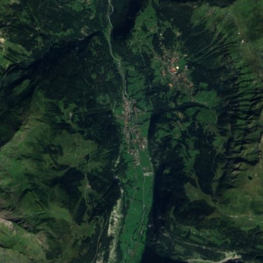
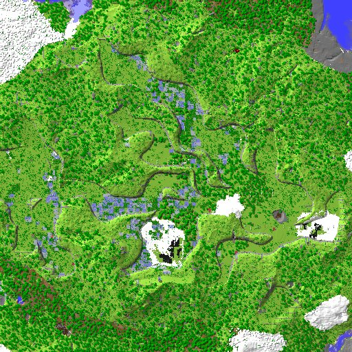
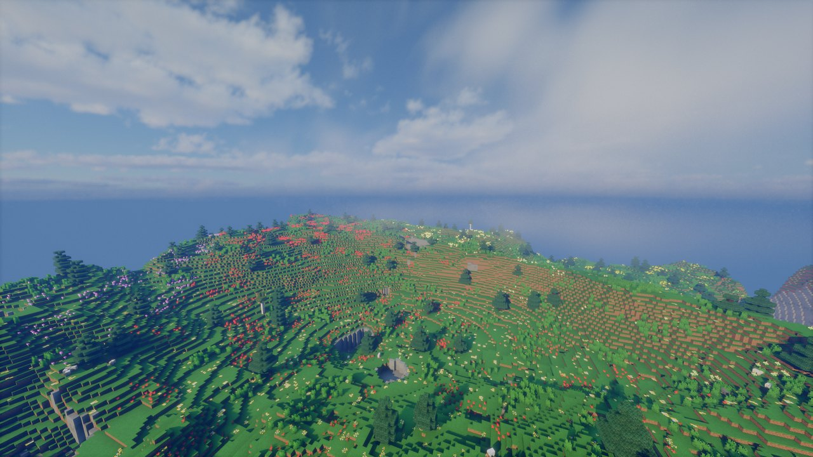

# Lauterbrunnen Valley / 라우터브루넨 계곡

**Real place:** Lauterbrunnen Valley (Staubbach Falls), Switzerland (46.5930, 7.9090)

A textbook glacial trough: flat green floor between 300-500 m limestone cliffs from which 72 waterfalls, Staubbach the best known, drop free into the valley.

**In game:** `biomesmod:lauterbrunnen`, a site of 720–880 blocks across (mountains, low land raised, y=135). Find the nearest one with `/biomesmod sites lauterbrunnen`.

| Satellite (real place) | In-game map (top-down) | In-game view |
|---|---|---|
|  |  |  |

Satellite: [Sentinel-2 cloudless 2016 by EOX IT Services GmbH (contains modified Copernicus Sentinel data 2016)](https://s2maps.eu), CC BY 4.0 ([licence](https://creativecommons.org/licenses/by/4.0/)). In-game images: seed 0, Minecraft 26.2; the view uses Iris + Bliss shaders, Sodium and Voxy.

[Back to the gallery](README.md)
