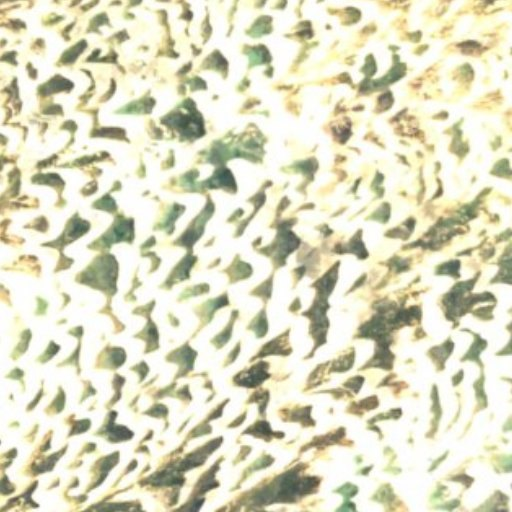
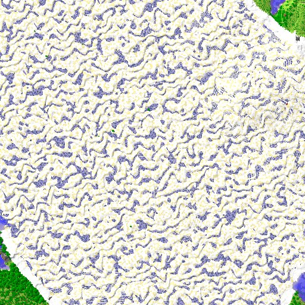
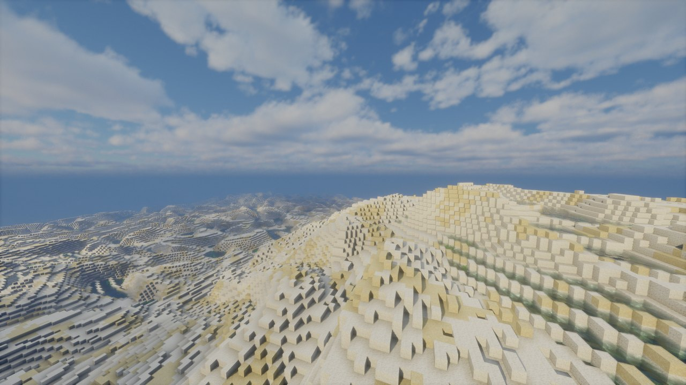

# Lençóis Maranhenses / 렌소이스 마라냥세스

**Real place:** Lençóis Maranhenses National Park, Brazil (-2.4826, -43.1250)

A coastal field of white quartz dunes up to 40 m; in the rainy season every hollow between the crests fills with blue-green rain lagoons.

**In game:** `biomesmod:lencois_maranhenses`, a site of 1000–1400 blocks across (original terrain, shaped by landforms). Find the nearest one with `/biomesmod sites lencois_maranhenses`.

| Satellite (real place) | In-game map (top-down) | In-game view |
|---|---|---|
|  |  |  |

Satellite: [Sentinel-2 cloudless 2016 by EOX IT Services GmbH (contains modified Copernicus Sentinel data 2016)](https://s2maps.eu), CC BY 4.0 ([licence](https://creativecommons.org/licenses/by/4.0/)). In-game images: seed 0, Minecraft 26.2; the view uses Iris + Bliss shaders, Sodium and Voxy.

[Back to the gallery](README.md)
