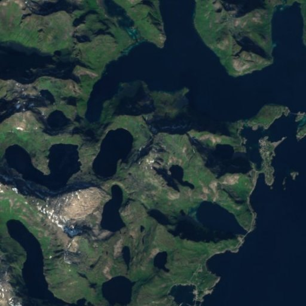
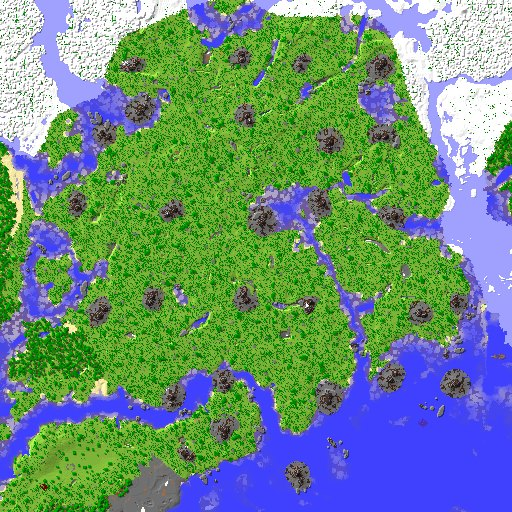
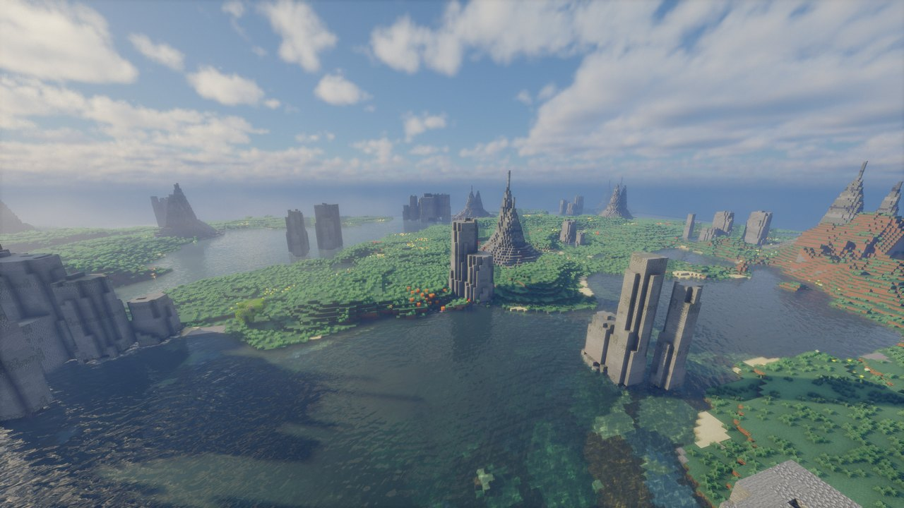

# Lofoten Peaks / 로포텐 봉우리

**Real place:** Lofoten peaks above Reine (Moskenesøya), Norway (67.9326, 13.0191)

Granite horns over 700 m rise straight from the sea around Reine; red fishing cabins sit on skerries at their feet.

**In game:** `biomesmod:lofoten_reine`, a site of 652–798 blocks across (original terrain, shaped by landforms). Find the nearest one with `/biomesmod sites lofoten_reine`.

| Satellite (real place) | In-game map (top-down) | In-game view |
|---|---|---|
|  |  |  |

Satellite: [Sentinel-2 cloudless 2016 by EOX IT Services GmbH (contains modified Copernicus Sentinel data 2016)](https://s2maps.eu), CC BY 4.0 ([licence](https://creativecommons.org/licenses/by/4.0/)). In-game images: seed 0, Minecraft 26.2; the view uses Iris + Bliss shaders, Sodium and Voxy.

[Back to the gallery](README.md)
