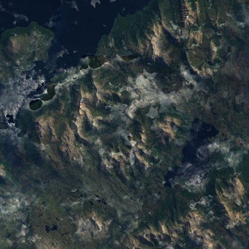
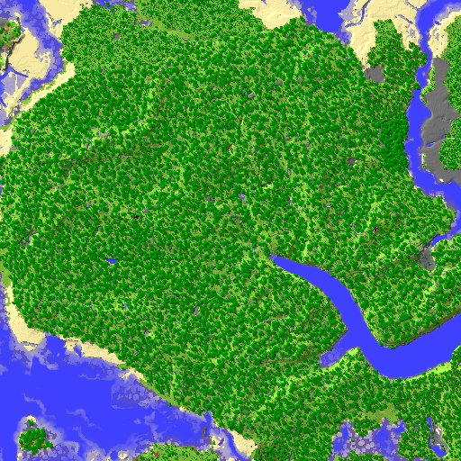
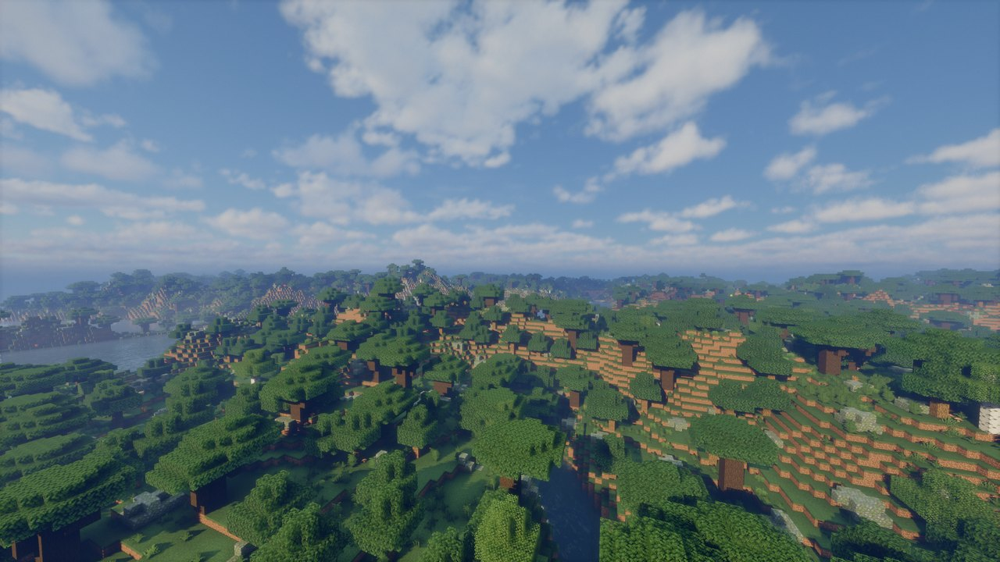

# Magellanic Forest / 마젤란 숲

**Real place:** Riesco Island and the Magellanic channels, Chile (-52.8327, -72.2448)

Cold, wet hills of lenga and coigüe beech forest, peat bogs and wind-bent trees around the fjords and channels north of the Strait of Magellan.

**In game:** `biomesmod:magellanic_fjords`, a site of 652–798 blocks across (mountains, low land raised, y=87). Find the nearest one with `/biomesmod sites magellanic_fjords`.

| Satellite (real place) | In-game map (top-down) | In-game view |
|---|---|---|
|  |  |  |

Satellite: [Sentinel-2 cloudless 2016 by EOX IT Services GmbH (contains modified Copernicus Sentinel data 2016)](https://s2maps.eu), CC BY 4.0 ([licence](https://creativecommons.org/licenses/by/4.0/)). In-game images: seed 0, Minecraft 26.2; the view uses Iris + Bliss shaders, Sodium and Voxy.

[Back to the gallery](README.md)
