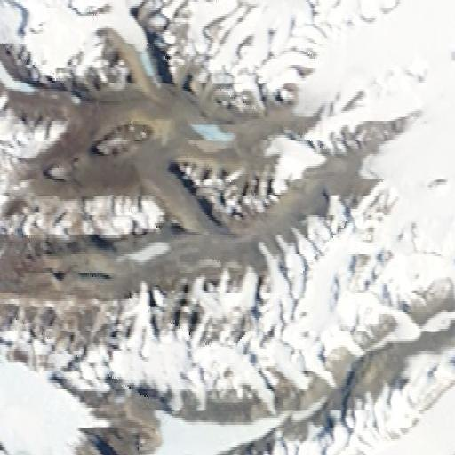
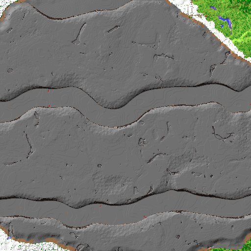
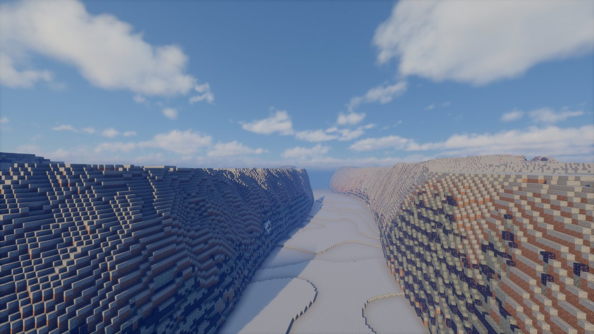

# McMurdo Dry Valleys / 맥머도 드라이 밸리

**Real place:** Wright Valley, McMurdo Dry Valleys (Lake Vanda), Antarctica (-77.5000, 162.0000)

The largest ice-free area of Antarctica: brown gravel and sand valleys with wind-sculpted ventifacts, the frozen Lake Vanda and the Onyx River, under dark dolerite-capped walls.

**In game:** `biomesmod:mcmurdo_dry_valleys`, a site of 960–1240 blocks across (raised land, y=100). Find the nearest one with `/biomesmod sites mcmurdo_dry_valleys`.

| Satellite (real place) | In-game map (top-down) | In-game view |
|---|---|---|
|  |  |  |

Satellite: [NASA Worldview / GIBS (MODIS Terra corrected reflectance)](https://worldview.earthdata.nasa.gov), public domain ([licence](https://www.earthdata.nasa.gov/engage/open-data-services-software-policies)). In-game images: seed 0, Minecraft 26.2; the view uses Iris + Bliss shaders, Sodium and Voxy.

[Back to the gallery](README.md)
