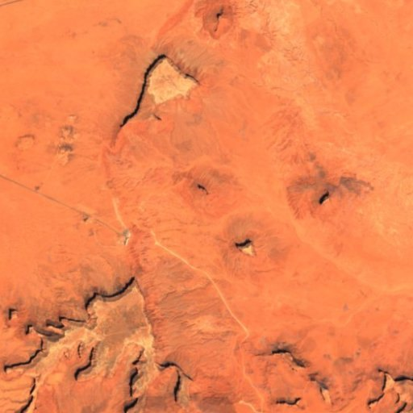
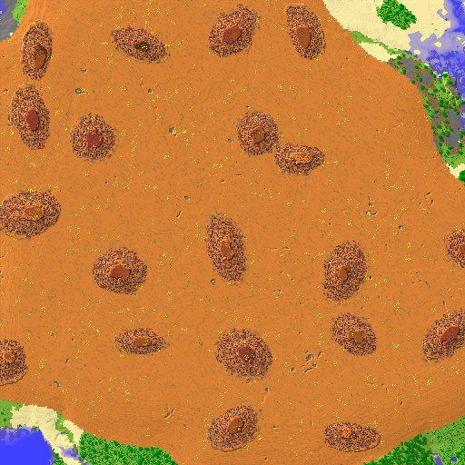
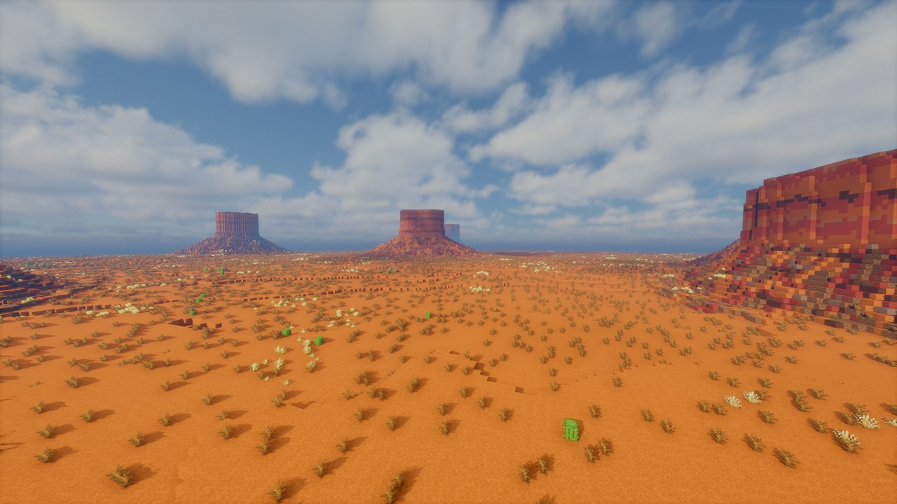

# Monument Valley / 모뉴먼트 밸리

**Real place:** Monument Valley (Mitten Buttes, Merrick Butte), United States (36.9875, -110.0950)

Sandstone buttes up to 300 m stand on red sand plains; the Mittens have a slender 'thumb' spire beside their main block, all on talus aprons of shale.

**In game:** `biomesmod:monument_valley`, a site of 920–1200 blocks across (flat plateau, y=129). Find the nearest one with `/biomesmod sites monument_valley`.

| Satellite (real place) | In-game map (top-down) | In-game view |
|---|---|---|
|  |  |  |

Satellite: [Sentinel-2 cloudless 2016 by EOX IT Services GmbH (contains modified Copernicus Sentinel data 2016)](https://s2maps.eu), CC BY 4.0 ([licence](https://creativecommons.org/licenses/by/4.0/)). In-game images: seed 0, Minecraft 26.2; the view uses Iris + Bliss shaders, Sodium and Voxy.

[Back to the gallery](README.md)
