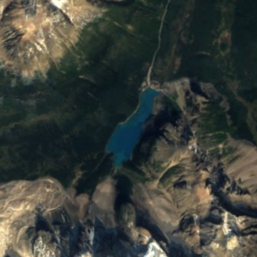
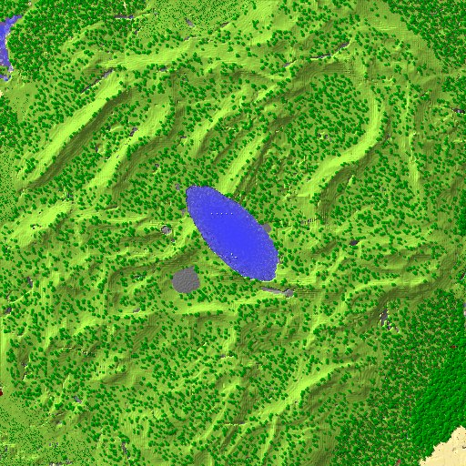
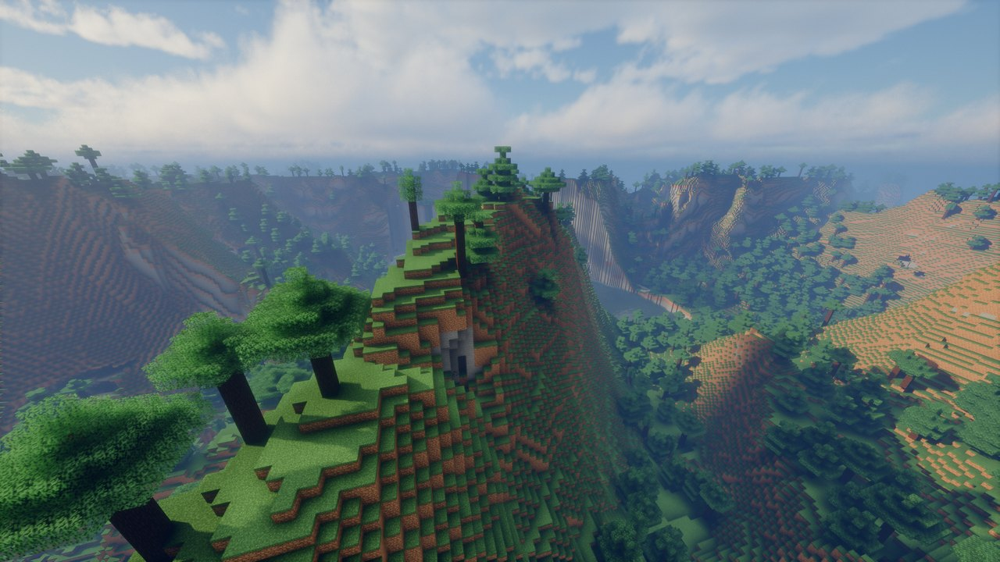

# Moraine Lake / 모레인 호수

**Real place:** Moraine Lake (Valley of the Ten Peaks, Banff), Canada (51.3217, -116.1860)

A glacier-fed lake of vivid turquoise rock-flour water below the ten peaks' cliffs, dammed by a rockpile, ringed by spruce and larch.

**In game:** `biomesmod:moraine_lake`, a site of 840–1120 blocks across (mountains, low land raised, y=137). Find the nearest one with `/biomesmod sites moraine_lake`.

| Satellite (real place) | In-game map (top-down) | In-game view |
|---|---|---|
|  |  |  |

Satellite: [Sentinel-2 cloudless 2016 by EOX IT Services GmbH (contains modified Copernicus Sentinel data 2016)](https://s2maps.eu), CC BY 4.0 ([licence](https://creativecommons.org/licenses/by/4.0/)). In-game images: seed 0, Minecraft 26.2; the view uses Iris + Bliss shaders, Sodium and Voxy.

[Back to the gallery](README.md)
