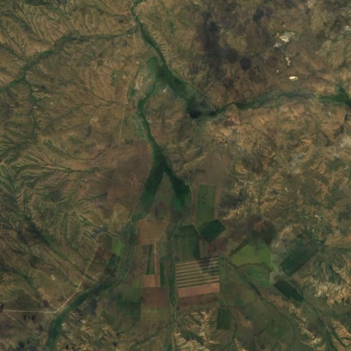
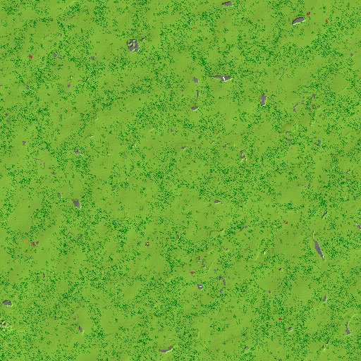
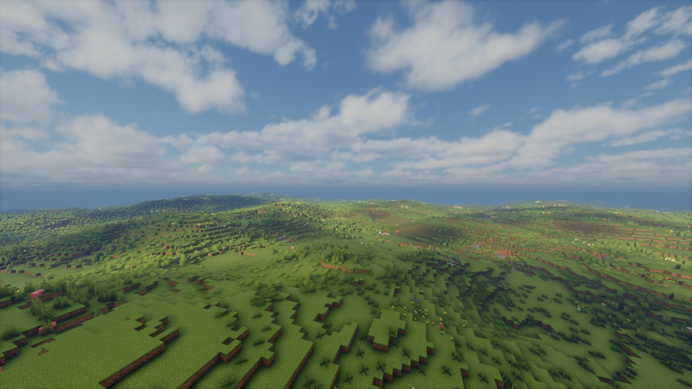

# Orkhon Steppe / 오르혼 초원

**Real place:** Orkhon Valley steppe near Kharkhorin, Mongolia (47.0000, 103.0000)

The Orkhon Valley's rolling grassland at 1,500 m: open steppe with gentle hills, the meandering river and scattered gers, the ancient heart of the Mongol empire.

**In game:** `biomesmod:orkhon_steppe`, a site of 1160–1500 blocks across (raised land, y=124). Find the nearest one with `/biomesmod sites orkhon_steppe`.

| Satellite (real place) | In-game map (top-down) | In-game view |
|---|---|---|
|  |  |  |

Satellite: [Sentinel-2 cloudless 2016 by EOX IT Services GmbH (contains modified Copernicus Sentinel data 2016)](https://s2maps.eu), CC BY 4.0 ([licence](https://creativecommons.org/licenses/by/4.0/)). In-game images: seed 0, Minecraft 26.2; the view uses Iris + Bliss shaders, Sodium and Voxy.

[Back to the gallery](README.md)
