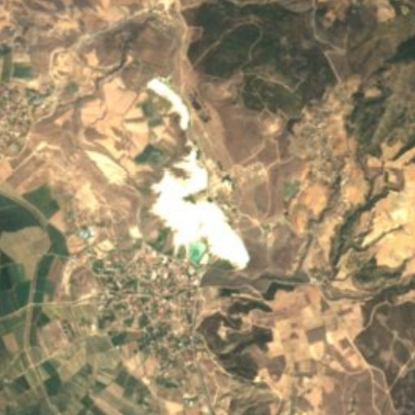
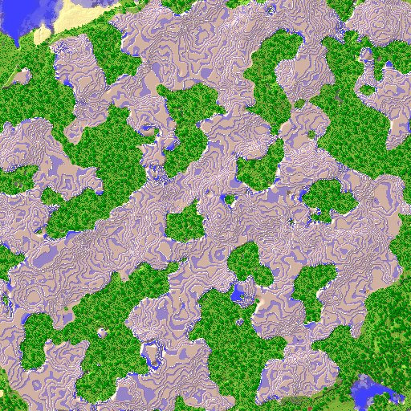
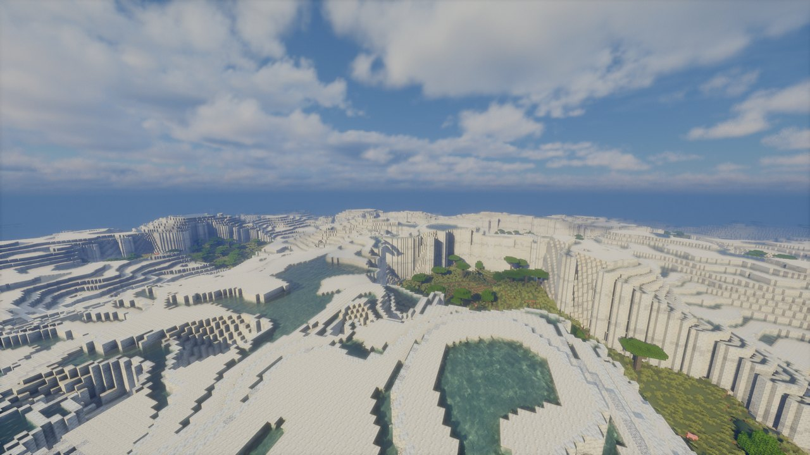

# Pamukkale / 파묵칼레

**Real place:** Pamukkale travertines (Hierapolis), Turkey (37.9239, 29.1233)

A hillside of snow-white travertine terraces built by hot calcium-rich springs: scalloped pools of milky turquoise water stepping down the slope.

**In game:** `biomesmod:pamukkale`, a site of 800–1040 blocks across (raised land, y=80). Find the nearest one with `/biomesmod sites pamukkale`.

| Satellite (real place) | In-game map (top-down) | In-game view |
|---|---|---|
|  |  |  |

Satellite: [Sentinel-2 cloudless 2016 by EOX IT Services GmbH (contains modified Copernicus Sentinel data 2016)](https://s2maps.eu), CC BY 4.0 ([licence](https://creativecommons.org/licenses/by/4.0/)). In-game images: seed 0, Minecraft 26.2; the view uses Iris + Bliss shaders, Sodium and Voxy.

[Back to the gallery](README.md)
