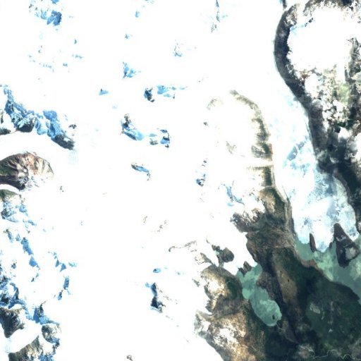
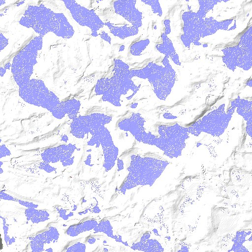
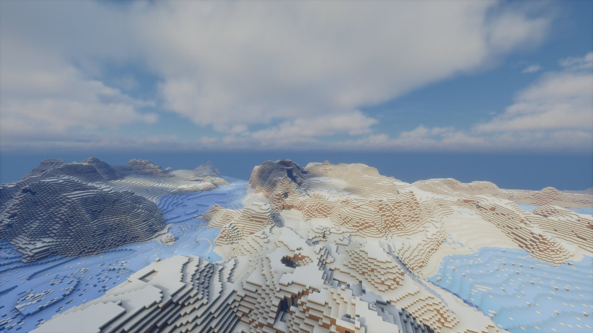

# Patagonian Ice Field / 파타고니아 빙원

**Real place:** Southern Patagonian Ice Field above Grey Glacier (Torres del Paine), Chile (-50.9423, -73.4068)

West of the Torres del Paine massif the land is buried under the Southern Patagonian Ice Field, which feeds Grey Glacier; 8.5 m of yearly precipitation, crevassed ice and nunataks.

**In game:** `biomesmod:patagonian_icefield`, a site of 1120–1400 blocks across (raised land, y=122). Find the nearest one with `/biomesmod sites patagonian_icefield`.

| Satellite (real place) | In-game map (top-down) | In-game view |
|---|---|---|
|  |  |  |

Satellite: [Sentinel-2 cloudless 2016 by EOX IT Services GmbH (contains modified Copernicus Sentinel data 2016)](https://s2maps.eu), CC BY 4.0 ([licence](https://creativecommons.org/licenses/by/4.0/)). In-game images: seed 0, Minecraft 26.2; the view uses Iris + Bliss shaders, Sodium and Voxy.

[Back to the gallery](README.md)
