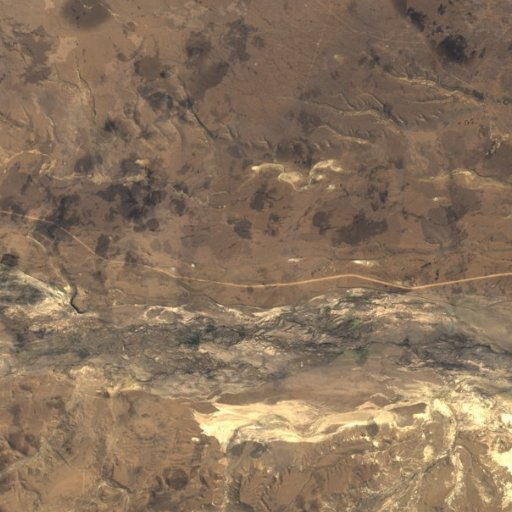
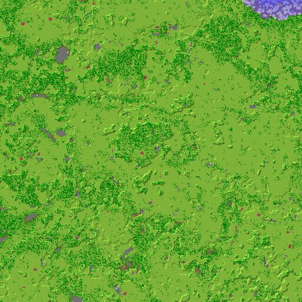
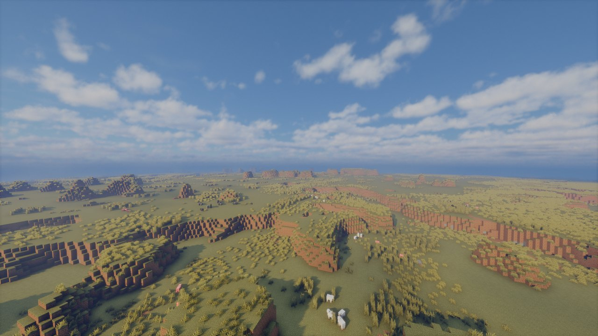

# Patagonian Steppe / 파타고니아 스텝

**Real place:** Patagonian steppe of Santa Cruz (Corpen Aike), Argentina (-49.5000, -70.5000)

Wind-scoured, treeless steppe of golden coirón grass and cushion shrubs on stepped basalt-capped mesetas; guanacos, rheas and endless sky.

**In game:** `biomesmod:patagonian_steppe`, a site of 1160–1500 blocks across (raised land, y=72). Find the nearest one with `/biomesmod sites patagonian_steppe`.

| Satellite (real place) | In-game map (top-down) | In-game view |
|---|---|---|
|  |  |  |

Satellite: [Sentinel-2 cloudless 2016 by EOX IT Services GmbH (contains modified Copernicus Sentinel data 2016)](https://s2maps.eu), CC BY 4.0 ([licence](https://creativecommons.org/licenses/by/4.0/)). In-game images: seed 0, Minecraft 26.2; the view uses Iris + Bliss shaders, Sodium and Voxy.

[Back to the gallery](README.md)
