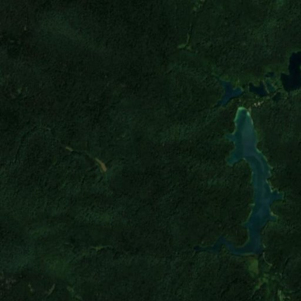
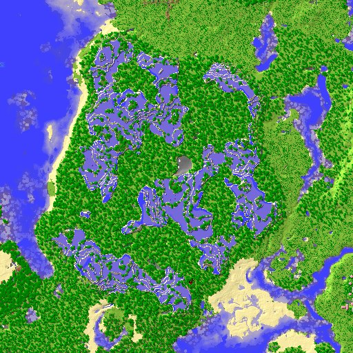
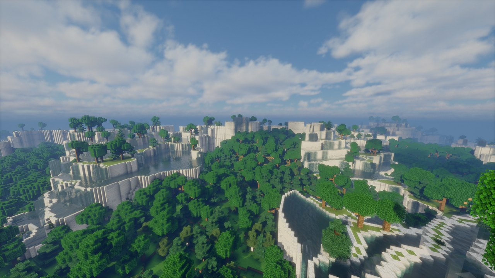

# Plitvice Lakes / 플리트비체 호수

**Real place:** Plitvice Lakes National Park, Croatia (44.8654, 15.5820)

Sixteen terraced lakes in karst, separated by travertine barriers over which countless waterfalls spill; turquoise water inside beech-fir forest.

**In game:** `biomesmod:plitvice_lakes`, a site of 540–660 blocks across (raised land, y=95). Find the nearest one with `/biomesmod sites plitvice_lakes`.

| Satellite (real place) | In-game map (top-down) | In-game view |
|---|---|---|
|  |  |  |

Satellite: [Sentinel-2 cloudless 2024 by EOX IT Services GmbH (contains modified Copernicus Sentinel data 2024)](https://s2maps.eu), CC BY-NC-SA 4.0 ([licence](https://creativecommons.org/licenses/by-nc-sa/4.0/)). In-game images: seed 0, Minecraft 26.2; the view uses Iris + Bliss shaders, Sodium and Voxy.

[Back to the gallery](README.md)
