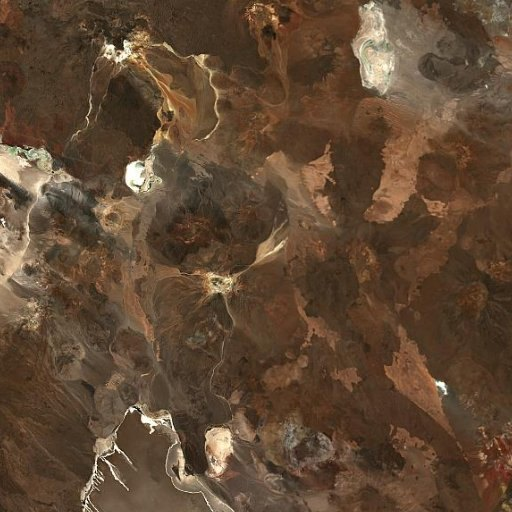
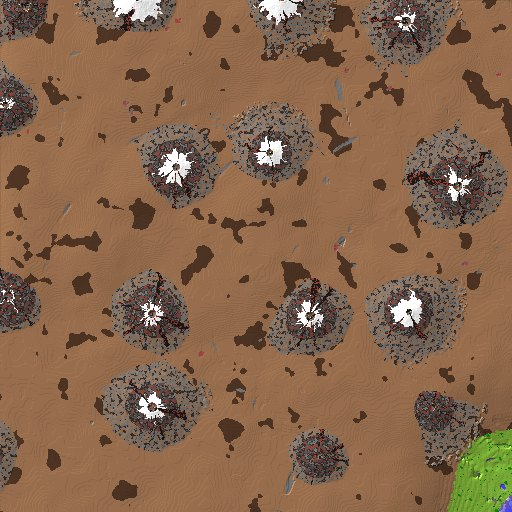
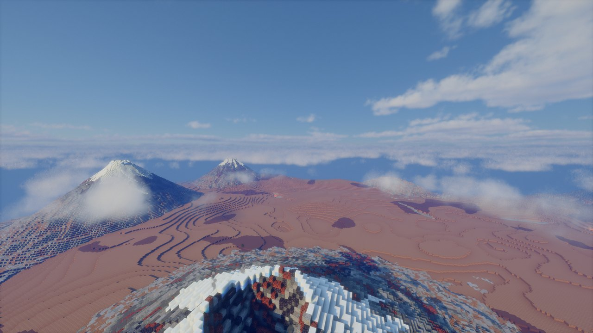

# Puna de Atacama / 푸나 데 아타카마

**Real place:** Puna de Atacama high plateau, Chile / Argentina (-24.0000, -67.5000)

At 4,500 m the Puna is a cold, hyper-dry plateau of ochre gravel plains, salt pans and snow-dusted volcanic cones; vicuñas graze the sparse bunchgrass.

**In game:** `biomesmod:puna_de_atacama`, a site of 1120–1400 blocks across (raised land, y=240). Find the nearest one with `/biomesmod sites puna_de_atacama`.

| Satellite (real place) | In-game map (top-down) | In-game view |
|---|---|---|
|  |  |  |

Satellite: [Sentinel-2 cloudless 2024 by EOX IT Services GmbH (contains modified Copernicus Sentinel data 2024)](https://s2maps.eu), CC BY-NC-SA 4.0 ([licence](https://creativecommons.org/licenses/by-nc-sa/4.0/)). In-game images: seed 0, Minecraft 26.2; the view uses Iris + Bliss shaders, Sodium and Voxy.

[Back to the gallery](README.md)
