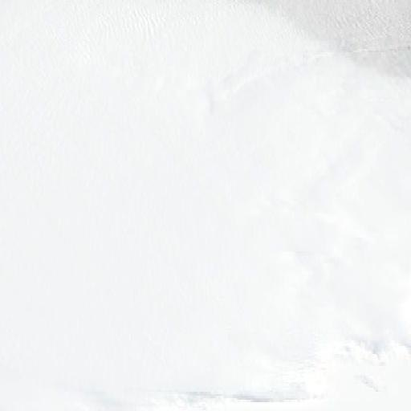
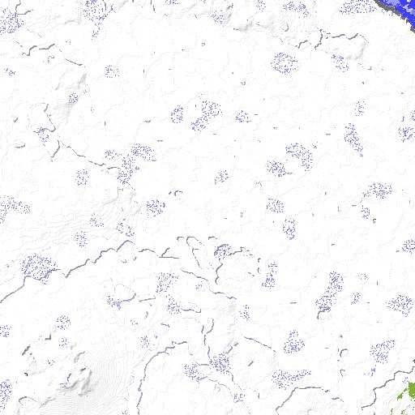
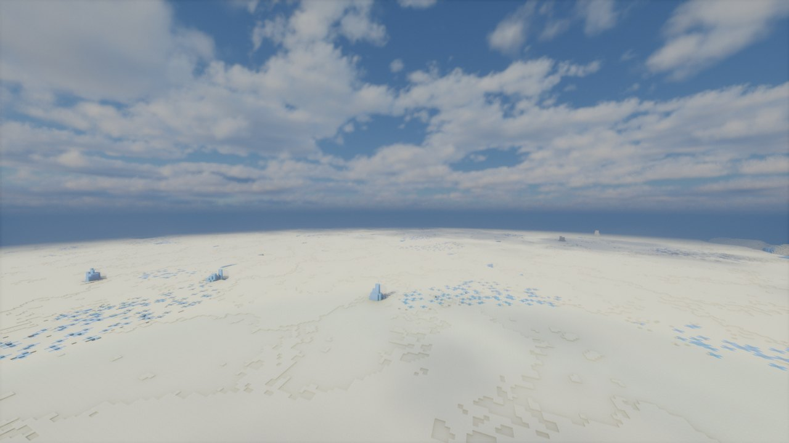

# Ross Ice Shelf / 로스 빙붕

**Real place:** Ross Ice Shelf, Antarctica (-78.0000, 175.0000)

The largest ice shelf on Earth, a floating plain of ice hundreds of metres thick ending at a 50 m ice cliff; utterly flat to the horizon.

**In game:** `biomesmod:ross_ice_shelf`, a site of 1200–1600 blocks across (original terrain, shaped by landforms). Find the nearest one with `/biomesmod sites ross_ice_shelf`.

| Satellite (real place) | In-game map (top-down) | In-game view |
|---|---|---|
|  |  |  |

Satellite: [NASA Worldview / GIBS (MODIS Terra corrected reflectance)](https://worldview.earthdata.nasa.gov), public domain ([licence](https://www.earthdata.nasa.gov/engage/open-data-services-software-policies)). In-game images: seed 0, Minecraft 26.2; the view uses Iris + Bliss shaders, Sodium and Voxy.

[Back to the gallery](README.md)
