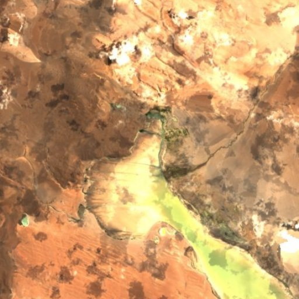
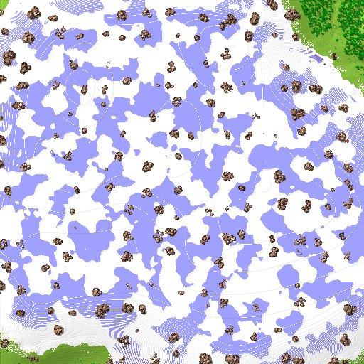
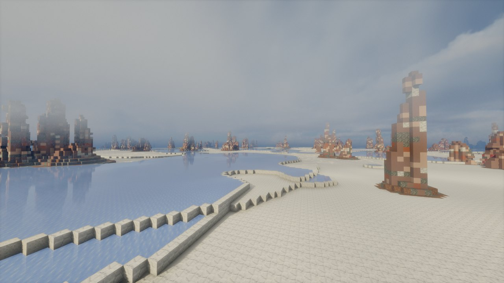

# Salar de Tara / 타라 염호

**Real place:** Salar de Tara (Los Flamencos National Reserve), Chile (-23.0000, -67.3000)

A salt lagoon at 4,300 m ringed by ochre hills and wind-carved ignimbrite towers (the 'Monjes de Pacana'); flamingos feed in shallow pink-white brine.

**In game:** `biomesmod:salar_de_tara`, a site of 880–1120 blocks across (flat plateau, y=248). Find the nearest one with `/biomesmod sites salar_de_tara`.

| Satellite (real place) | In-game map (top-down) | In-game view |
|---|---|---|
|  |  |  |

Satellite: [Sentinel-2 cloudless 2016 by EOX IT Services GmbH (contains modified Copernicus Sentinel data 2016)](https://s2maps.eu), CC BY 4.0 ([licence](https://creativecommons.org/licenses/by/4.0/)). In-game images: seed 0, Minecraft 26.2; the view uses Iris + Bliss shaders, Sodium and Voxy.

[Back to the gallery](README.md)
