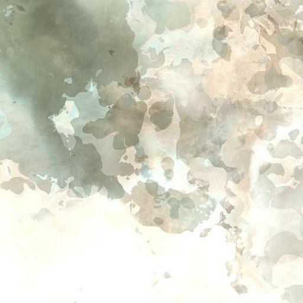
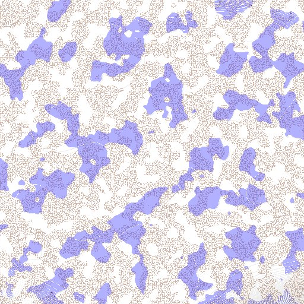
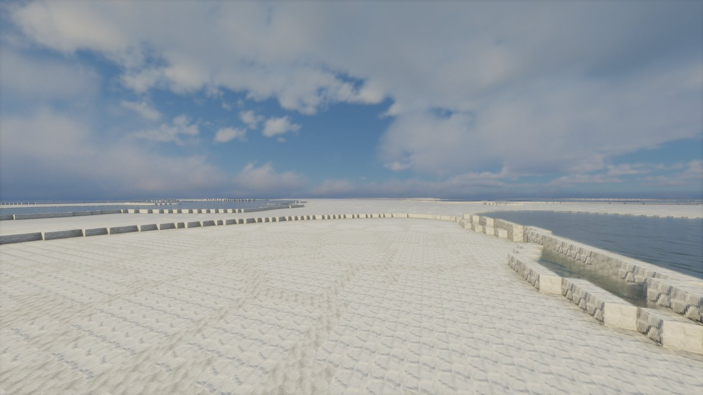

# Salar de Uyuni / 우유니 소금사막

**Real place:** Salar de Uyuni, Bolivia (-20.1338, -67.4891)

The world's largest salt flat (10,582 km2) at 3,656 m: dead-flat white crust in polygonal hexagons; a thin film of rain water turns it into a sky mirror.

**In game:** `biomesmod:salar_de_uyuni`, a site of 1240–1400 blocks across (flat plateau, y=231). Find the nearest one with `/biomesmod sites salar_de_uyuni`.

| Satellite (real place) | In-game map (top-down) | In-game view |
|---|---|---|
|  |  |  |

Satellite: [Sentinel-2 cloudless 2024 by EOX IT Services GmbH (contains modified Copernicus Sentinel data 2024)](https://s2maps.eu), CC BY-NC-SA 4.0 ([licence](https://creativecommons.org/licenses/by-nc-sa/4.0/)). In-game images: seed 0, Minecraft 26.2; the view uses Iris + Bliss shaders, Sodium and Voxy.

[Back to the gallery](README.md)
