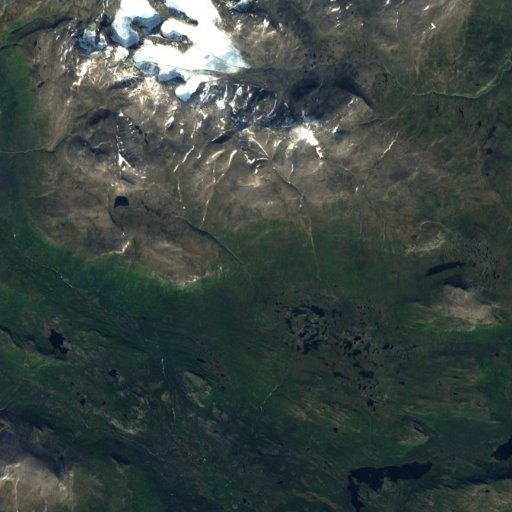
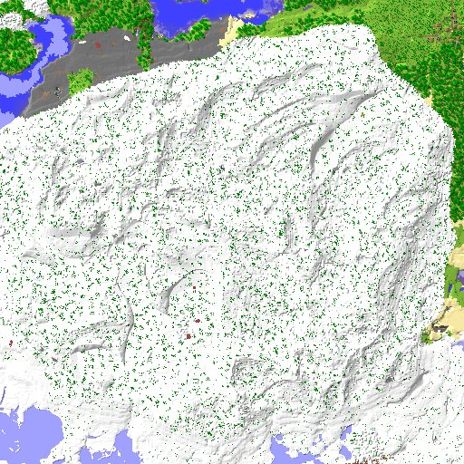
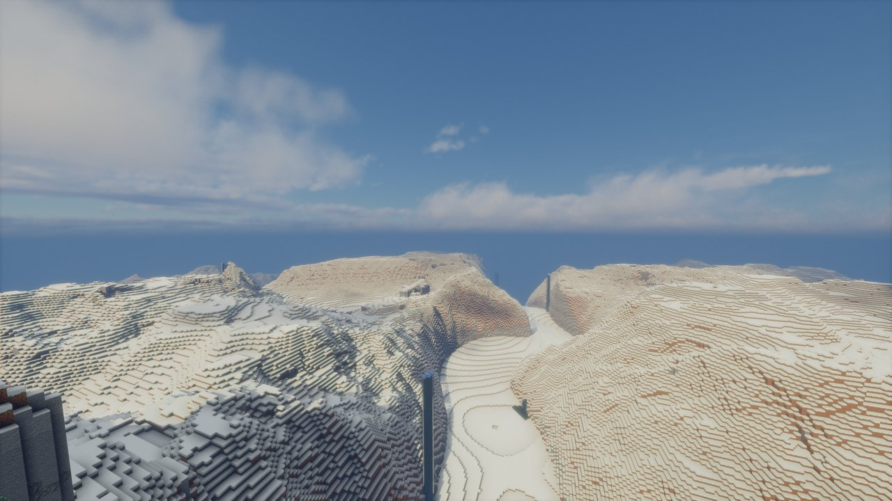

# Sarek / 사렉

**Real place:** Southern Sarek National Park (Pårte massif), Sweden (Lapland) (67.1000, 17.7000)

Sweden's wildest park: alpine tundra, small hanging glaciers and deep U-shaped valleys like Rapadalen, with mountain birch below the treeline.

**In game:** `biomesmod:sarek`, a site of 720–880 blocks across (mountains, low land raised, y=110). Find the nearest one with `/biomesmod sites sarek`.

| Satellite (real place) | In-game map (top-down) | In-game view |
|---|---|---|
|  |  |  |

Satellite: [Sentinel-2 cloudless 2016 by EOX IT Services GmbH (contains modified Copernicus Sentinel data 2016)](https://s2maps.eu), CC BY 4.0 ([licence](https://creativecommons.org/licenses/by/4.0/)). In-game images: seed 0, Minecraft 26.2; the view uses Iris + Bliss shaders, Sodium and Voxy.

[Back to the gallery](README.md)
