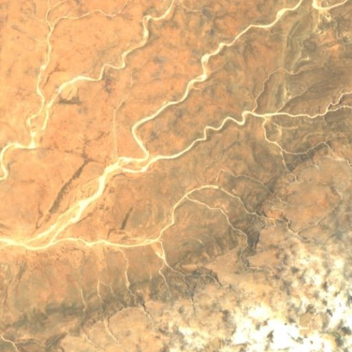
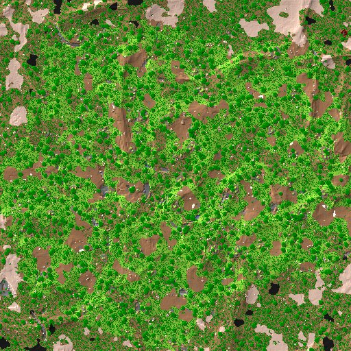
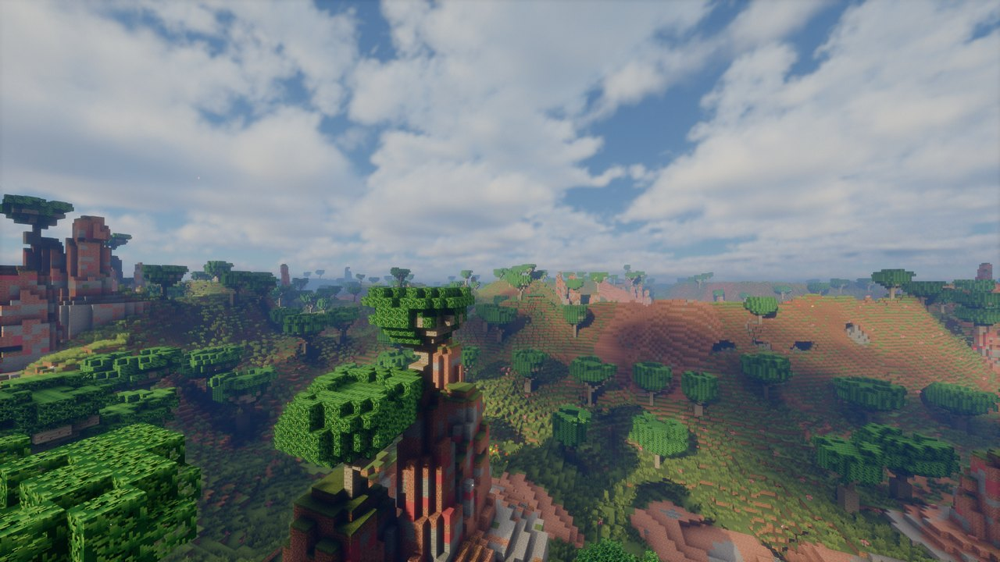

# Socotra Dragon's Blood Plateau / 소코트라 용혈수 고원

**Real place:** Socotra highlands west of the Diksam plateau, Yemen (12.4500, 53.8167)

Socotra's limestone plateaus and wadis carry endemic dragon's blood trees with dense umbrella crowns, bottle trees and frankincense on pale rock.

**In game:** `biomesmod:socotra`, a site of 764–936 blocks across (raised land, y=92). Find the nearest one with `/biomesmod sites socotra`.

| Satellite (real place) | In-game map (top-down) | In-game view |
|---|---|---|
|  |  |  |

Satellite: [Sentinel-2 cloudless 2016 by EOX IT Services GmbH (contains modified Copernicus Sentinel data 2016)](https://s2maps.eu), CC BY 4.0 ([licence](https://creativecommons.org/licenses/by/4.0/)). In-game images: seed 0, Minecraft 26.2; the view uses Iris + Bliss shaders, Sodium and Voxy.

[Back to the gallery](README.md)
