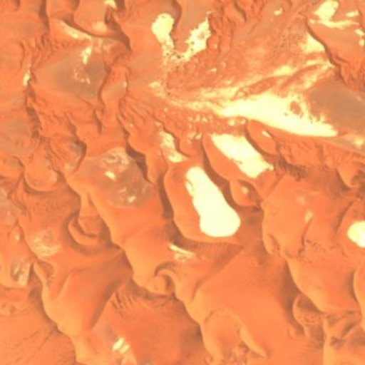
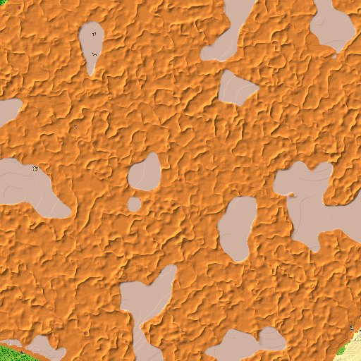
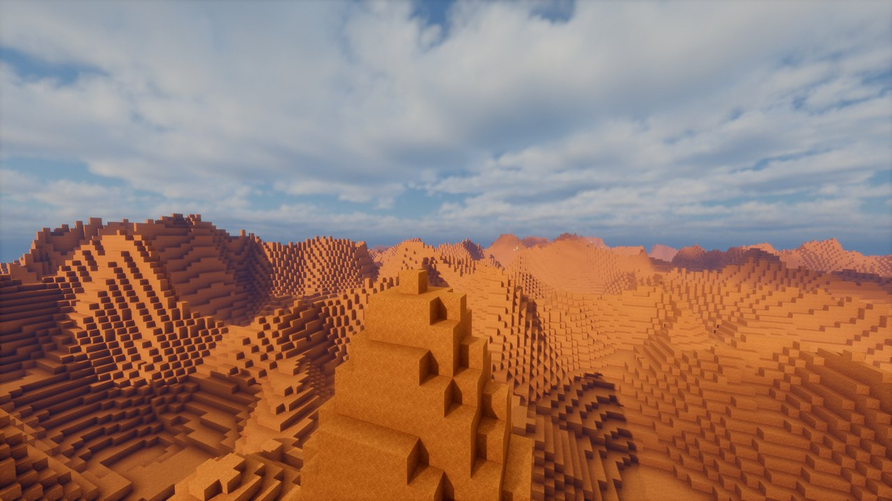

# Sossusvlei / 소수스블레이

**Real place:** Deadvlei / Sossusvlei, Namib-Naukluft, Namibia (-24.7600, 15.2900)

Star dunes over 300 m of rust-red sand surround white clay pans; in Deadvlei the black skeletons of 900-year-old camel thorn trees stand on the cracked white floor.

**In game:** `biomesmod:sossusvlei`, a site of 1040–1320 blocks across (raised land, y=85). Find the nearest one with `/biomesmod sites sossusvlei`.

| Satellite (real place) | In-game map (top-down) | In-game view |
|---|---|---|
|  |  |  |

Satellite: [Sentinel-2 cloudless 2016 by EOX IT Services GmbH (contains modified Copernicus Sentinel data 2016)](https://s2maps.eu), CC BY 4.0 ([licence](https://creativecommons.org/licenses/by/4.0/)). In-game images: seed 0, Minecraft 26.2; the view uses Iris + Bliss shaders, Sodium and Voxy.

[Back to the gallery](README.md)
