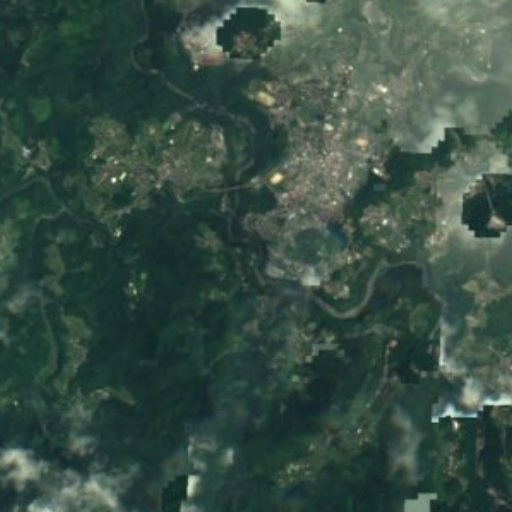
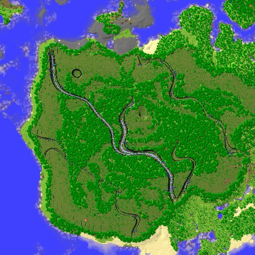
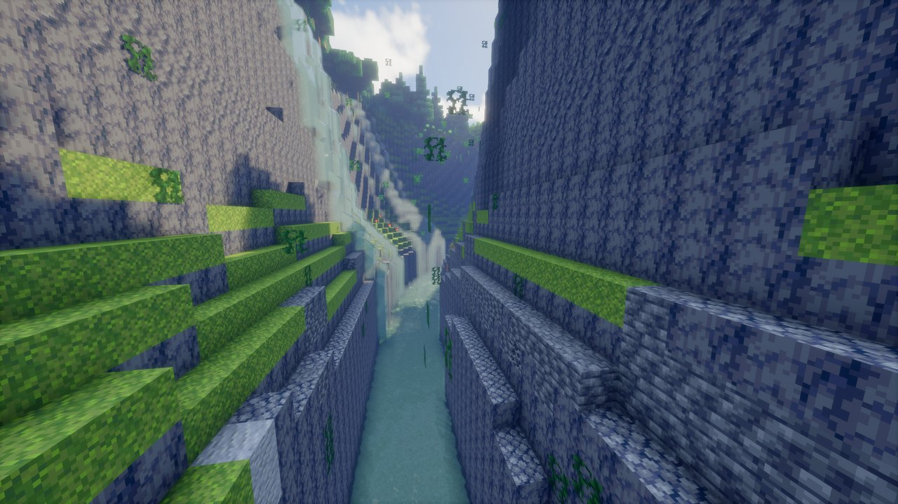

# Takachiho Gorge / 다카치호 협곡

**Real place:** Takachiho Gorge (Gokase River, Miyazaki), Japan (Kyushu) (32.7021, 131.3008)

A narrow gorge the Gokase River cut through lava flows of Mount Aso: sheer walls of columnar basalt 80 to 100 m high stand a few metres apart over emerald water, with the Manai Falls dropping into it from the forested plateau above.

**In game:** `biomesmod:takachiho_gorge`, a site of 600–720 blocks across (flat plateau, y=100). Find the nearest one with `/biomesmod sites takachiho_gorge`.

| Satellite (real place) | In-game map (top-down) | In-game view |
|---|---|---|
|  |  |  |

Satellite: [Sentinel-2 cloudless 2016 by EOX IT Services GmbH (contains modified Copernicus Sentinel data 2016)](https://s2maps.eu), CC BY 4.0 ([licence](https://creativecommons.org/licenses/by/4.0/)). In-game images: seed 0, Minecraft 26.2; the view uses Iris + Bliss shaders, Sodium and Voxy.

[Back to the gallery](README.md)
