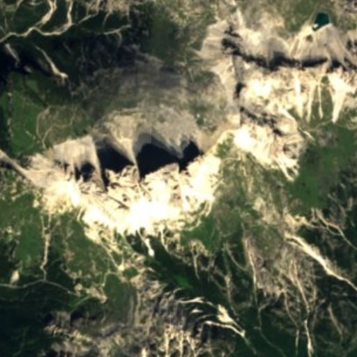
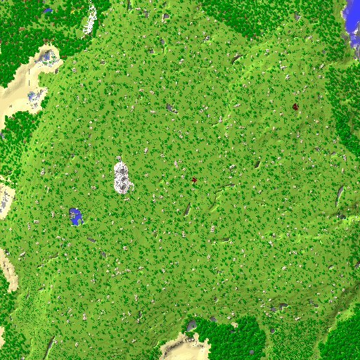
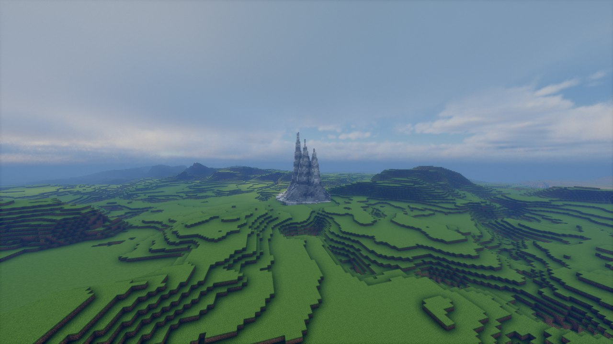

# Tre Cime / 트레 치메

**Real place:** Tre Cime di Lavaredo, Italy (Dolomites) (46.6186, 12.3056)

Three free-standing dolomite towers (up to 2,999 m) with vertical north faces, rising from pale scree fans above alpine meadows.

**In game:** `biomesmod:tre_cime`, a site of 540–660 blocks across (raised land, y=198). Find the nearest one with `/biomesmod sites tre_cime`.

| Satellite (real place) | In-game map (top-down) | In-game view |
|---|---|---|
|  |  |  |

Satellite: [Sentinel-2 cloudless 2016 by EOX IT Services GmbH (contains modified Copernicus Sentinel data 2016)](https://s2maps.eu), CC BY 4.0 ([licence](https://creativecommons.org/licenses/by/4.0/)). In-game images: seed 0, Minecraft 26.2; the view uses Iris + Bliss shaders, Sodium and Voxy.

[Back to the gallery](README.md)
