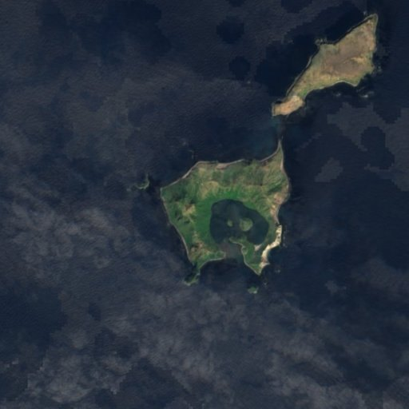
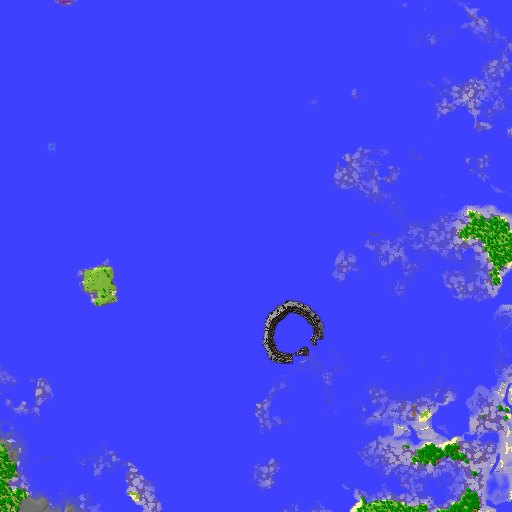
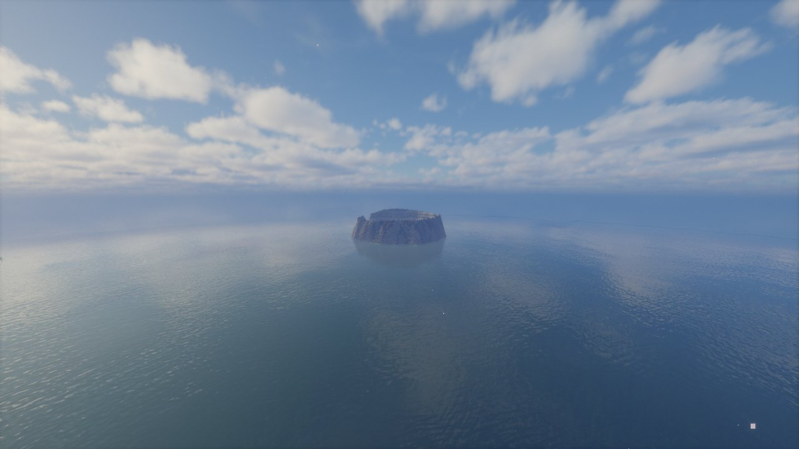

# Ushishir Caldera / 우시시르 칼데라

**Real place:** Ushishir Islands (Yankicha, Kraternaya Bay), Russia (Kuril Islands) (47.5160, 152.8060)

A small volcanic island group whose main island Yankicha is a collapsed caldera ring, breached on one side so the sea floods the crater as Kraternaya Bay; steaming fumaroles, seabird cliffs, low tundra.

**In game:** `biomesmod:ushishir_caldera`, a site of 540–660 blocks across (original terrain, shaped by landforms). Find the nearest one with `/biomesmod sites ushishir_caldera`.

| Satellite (real place) | In-game map (top-down) | In-game view |
|---|---|---|
|  |  |  |

Satellite: [Sentinel-2 cloudless 2016 by EOX IT Services GmbH (contains modified Copernicus Sentinel data 2016)](https://s2maps.eu), CC BY 4.0 ([licence](https://creativecommons.org/licenses/by/4.0/)). In-game images: seed 0, Minecraft 26.2; the view uses Iris + Bliss shaders, Sodium and Voxy.

[Back to the gallery](README.md)
